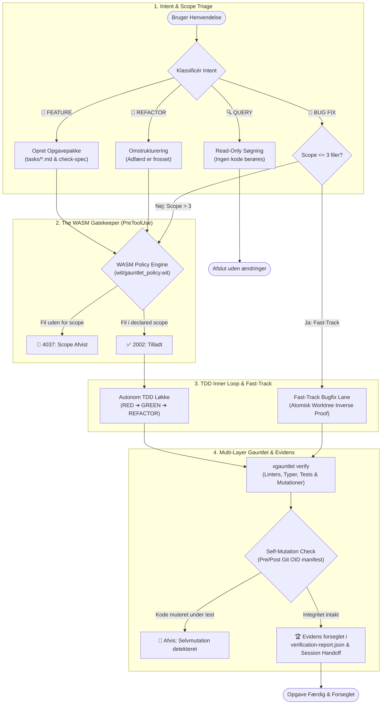
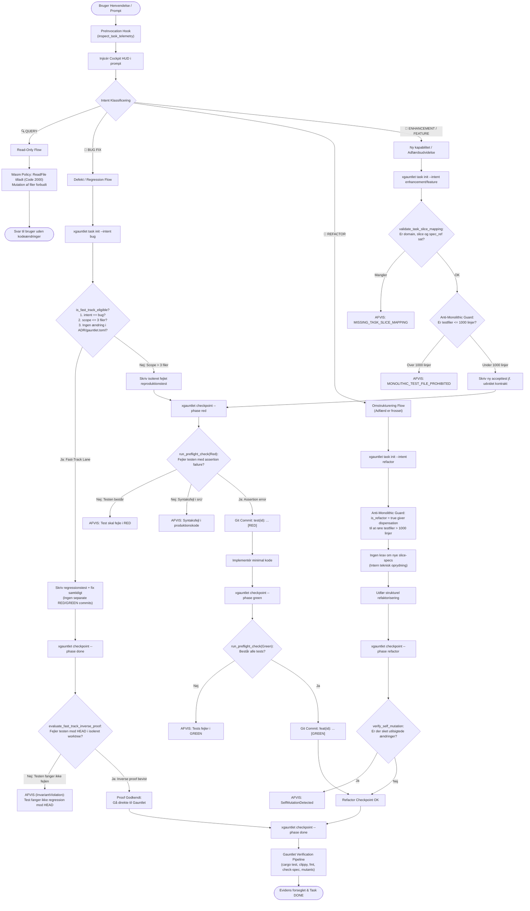

<p align="center">
  <a href="#-motivation-hvorfor-xgauntlet"><b>🎯 Motivation</b></a> •
  <a href="#️-arkitektur--de-3-søjler"><b>🏗️ Arkitektur</b></a> •
  <a href="#-sådan-virker-det-udviklingsflowet"><b>🧭 Udviklingsflow</b></a> •
  <a href="#-hurtig-start--installation"><b>🚀 Hurtig Start</b></a> •
  <a href="#️-cli-reference--arkitektur-gates"><b>🛠️ CLI Reference</b></a>
</p>

---

<p align="center">
  <h1 align="center">xGauntlet 🛡️</h1>
</p>

<p align="center">
  <em>Universel multi-stack verifikations- og actionable diagnostics motor bygget på Robert C. Martin ("Uncle Bob") TDD, Clean Craftsmanship & Zero-Daemon WebAssembly</em>
</p>

<p align="center">
  <a href="https://www.npmjs.com/package/xgauntlet"></a>
  <a href="https://github.com/rolfmadsen/xgauntlet/actions/workflows/ci.yml"></a>
  <a href="docs/adr/0005-two-tier-verification-and-attestation-model.md"></a>
  <a href="wit/gauntlet_policy.wit"></a>
  <a href="Cargo.toml"></a>
  <a href="LICENSE"></a>
</p>

---

**Dokumentation**: [Makro-Spec](spec.md) • [Domæne-Glossary](CONTEXT.md) • [Kodestandarder](CODING_STANDARDS.md) • [Arkitektur (ADRs)](docs/adr/) • [Agent-Skills](.agents/plugins/xgauntlet/skills/)  
**Kildekode & Pakker**: [GitHub](https://github.com/rolfmadsen/xgauntlet) • [NPM Pakke](packages/cli)

---

## 🎯 Motivation: Hvorfor xGauntlet?

### 🛑 Problemet med udisciplineret AI-kodning (Unconstrained AI)
Moderne AI-kodningsassistenter (som Claude Code, Google Antigravity, Cursor, Mistral Vibe og OpenAI Codex) er fabelagtigt hurtige til at generere kode. Men overladt til sig selv mangler de softwareingeniørens håndværksmæssige grænser:
* **De sletter eller udvander tests**, når assertions fejler, blot for at opnå grønne checks.
* **De laver "scope drift"** og modificerer utilsigtede konfigurationsfiler, hjælpepakker eller scripts langt uden for opgavens grænser.
* **De hallucinerer arkitektur**, bryder modulære grænser og glemmer domænets regler, så snart kontekstvinduet presses.
* **De efterlader tavs teknisk gæld**, fordi compiler-fejl og advarsler ikke systematisk oversættes til disciplinerede modtræk.

Kort sagt: *Fri og ubegrænset AI-kodning mangler deterministiske guardrails og ingeniørmæssig disciplin.*

### 🛡️ Hensigten: Clean Craftsmanship for Agentic Coding
**xGauntlet** løser dette ved at omslutte AI-agenten med et deterministisk **verification harness** baseret på principperne fra Robert C. Martin ("Uncle Bob"):

1. **Ingen kode uden forudgående test (Strict TDD):** Agenten kan ikke blot tilføje produktionskode; enhver adfærdsændring skal bevises gennem en forudgående, fejlet accepttest (*Red $\to$ Green $\to$ Refactor*).
2. **Nul utilsigtet autoritet (Zero Ambient Authority):** Agentens værktøjskald (tool calls) overvåges af en lynhurtig WebAssembly-motor, der fysisk forhindrer skrivning uden for opgavens erklærede `scope`.
3. **Matematisk forsegling (Evidence-First):** En opgave er først færdig, når hele verifikationskæden (linters, typer, tests og mutationer) er kørt og kryptografisk forseglet mod utilsigtet selvmutation.

---

## 🏗️ Arkitektur & De 3 Søjler

xGauntlet er ikke en tung cloud-service eller en baggrundsdæmon. Systemet er opbygget som et gennemskueligt samspil mellem tre uafhængige søjler:

```text
┌────────────────────────────────────────────────────────────────────────┐
│ 1. IN-REPO GOVERNANCE (Projektets deklarative sandhed i Git)           │
│    spec.md • CONTEXT.md • gauntlet.toml • tasks/*.md • docs/adr/       │
└───────────────────────────────────┬────────────────────────────────────┘
                                    │ styrer & begrænser
                                    ▼
┌────────────────────────────────────────────────────────────────────────┐
│ 2. SOVEREIGN AGENT SKILLS (Autonome proces-skills til AI-agenten)      │
│    discover • spec • tdd • review • diagnose • release                 │
└───────────────────────────────────┬────────────────────────────────────┘
                                    │ håndhæves mekanisk af
                                    ▼
┌────────────────────────────────────────────────────────────────────────┐
│ 3. THE GATEKEEPER (Deterministisk Native Rust + In-Memory WASM Motor)  │
│    xgauntlet CLI • gauntlet_policy.wasm (<3ms cold start, Zero-Daemon) │
└────────────────────────────────────────────────────────────────────────┘
```

### 1. In-Repo Governance (Single Source of Truth)
Alt hvad der styrer projektet ligger som almindelige, versionsstyrede tekstfiler direkte i dit repository. Når du kører `xgauntlet init`, oprettes følgende deklarative fundament:

| Fil / Mappe | Type | Formål |
|---|---|---|
| [`gauntlet.toml`](gauntlet.toml) | **Fælles** | Deklarativ konfiguration af lintere, typer, tests og verifikationslag. |
| [`CONTEXT.md`](CONTEXT.md) | **Fælles** | Domæne-glossary for projektet baseret på Aristoteles' *definitio per genus et differentiam*. |
| [`CODING_STANDARDS.md`](CODING_STANDARDS.md) | **Fælles** | Multi-stack kodestandarder og arkitekturinvarianter. |
| [`spec.md`](spec.md) | **Fælles** | Makro-specifikation og globale system-invarianter. |
| [`tasks/001-bootstrap.md`](tasks/) | **Fælles** | Opgavemappe til håndhævelse af task-kontrakter, acceptkriterier og scope. |
| [`docs/adr/`](docs/adr/) | **Fælles** | Architecture Decision Records (ADR) til projekt-specifikke beslutninger. |
| [`.agents/AGENTS.md`](.agents/AGENTS.md) | **Antigravity / Gemini** | Retningslinjer for AI-agenter, Response HUD og task-management. |
| [`.agents/hooks.json`](.agents/hooks.json) | **Antigravity / Gemini** | PreToolUse gatekeeper hook konfiguration. |
| [`CLAUDE.md`](CLAUDE.md) | **Claude Code** | Retningslinjer og sikkerhedsinvarianter for Anthropic Claude Code. |

*Bemærk:* De 7 øverste filer er universelle for både mennesker og alle AI-agenter. De to harness-specifikke sæt (`CLAUDE.md` og `.agents/`) sameksisterer uden konflikter, så du frit kan skifte mellem f.eks. Google Antigravity og Claude Code på det samme projekt.

### 2. Sovereign Agent Skills (Proces & Roller)
De 6 sovereign agent-skills installeres én gang globalt på maskinen via `xgauntlet plugin install --global` (og findes i repoet under [`.agents/plugins/xgauntlet/skills/`](.agents/plugins/xgauntlet/skills/)). De fungerer som agentens kognitive kompas:
* [**`discover`**](.agents/plugins/xgauntlet/skills/discover/SKILL.md): Sokratisk sparring, udfordring af antagelser og opdatering af `CONTEXT.md` før kodning.
* [**`spec`**](.agents/plugins/xgauntlet/skills/spec/SKILL.md): Nedbrydning af krav i isolerede opgavepakker (`tasks/<id>-<slug>.md`) med skarpt `scope`.
* [**`tdd`**](.agents/plugins/xgauntlet/skills/tdd/SKILL.md): Streng Red-Green-Refactor udvikling med lokale Git-checkpoints.
* [**`review`**](.agents/plugins/xgauntlet/skills/review/SKILL.md): To-akset audit (Standarder vs. Krav) med Fowler code smells baseline.
* [**`diagnose`**](.agents/plugins/xgauntlet/skills/diagnose/SKILL.md): Disciplineret fejldiagnose-løkke (*Reproduce $\to$ Minimize $\to$ Hypothesize $\to$ Fix*).
* [**`release`**](.agents/plugins/xgauntlet/skills/release/SKILL.md): Release-readiness audit, changelog-verifikation og multi-digest integritetsforsegling.

### 3. The Gatekeeper (Runtime Policy Enforcement)
* **Zero-Daemon Arkitektur**: Bygget i ren **Rust** for lynhurtig sub-3ms opstartstid (*cold start*). Ingen baggrundstjenester, ingen dæmoner og ingen socket-nedbrud.
* **Zero Ambient Authority WASM Kerne ([ADR 0007](docs/adr/0007-local-transparent-supervisor-and-wasm-verifier.md))**: Indlejret Wasmtime policy-motor (`wit/gauntlet_policy.wit`), som evaluerer hvert værktøjskald in-memory uden adgang til eksterne ressourcer.
* **Matematisk Anti-Tamper Manifest (Self-Mutation Invariant)**: Beregner Git-tree/blob OID-hashes før og efter testkørsler; hvis agenten forsøger at mutere kildekode eller testassertions undervejs, afvises kørslen øjeblikkeligt (`verify_self_mutation`).

---

## 🧭 Sådan virker det: Udviklingsflowet

Udviklingsflowet i xGauntlet følger en fast, disciplineret livscyklus fra uformel idé til forseglet release:



### Pipelinen trin for trin

#### 1. Idé- og Kontekstafklaring (Sparring)
* **Type:** Metodisk proces (`discover` skill).
* **Hvad der sker:** Før der skrives specifikationer eller kode, interviewer agenten brugeren. Antagelser udfordres, begreber afstemmes i `CONTEXT.md`, og eventuelle arkitektoniske trade-offs dokumenteres i `docs/adr/`.
* **Kontrolpunkt:** Udvikleren godkender i direkte dialog. WASM-kernen tillader skrivning til dokumentationsfiler (`tasks/`, `spec.md`, `CONTEXT.md`, `docs/`) uanset opgavestatus.

#### 2. Specifikation & Task Scoping
* **Type:** Hård software-gate (`xgauntlet check-spec`).
* **Hvad der sker:** Opgaven defineres formelt i `tasks/<id>-<slug>.md` jf. OKF v0.2 med eksplicitte acceptkriterier (`- [ ]`), negative begrænsninger (`## 🚫 Must NOT`) og et erklæret `scope: [...]`.
* **Håndhævelse i koden:** `check-spec` parser opgaven og afviser med exit-kode 1, hvis formatering, kriterier eller Aristoteles-definitioner overtrædes.

#### 3. TDD Inner Loop under WASM Policy
* **Type:** Metodisk TDD + Hård runtime-beskyttelse (`xgauntlet hook <harness>`).
* **Hvad der sker:** Koden implementeres efter TDD-princippet med lokale Git-checkpoints:
  * `RED`: Skriv en fejlende accepttest (`checkpoint --phase red`).
  * `GREEN`: Skriv minimal kode for at få den til at passere (`checkpoint --phase green`).
  * `REFACTOR`: Ryd op i koden uden at ændre adfærd (`checkpoint --phase refactor`).
* **Håndhævelse i koden:**
  * **Fail-Closed Task Scope:** Skrivehandlinger (`WriteFile`) uden for opgavens erklærede `scope` blokeres øjeblikkeligt med `reason_code: 4037`.
  * **Destruktiv Beskyttelse:** Farlige kommandoer (`git push`, `git reset --hard`, `git clean -f`, `rm -rf /`) og wrapper-binærer (`sudo`, `eval`, `bash -c`) afvises fail-closed (`reason_code: 4039`).
  * **Fast-Track Bugfix Lane:** For små fejlrettelser (`intent: bug` og `scope <= 3` filer) tillader motoren, at separate RED/GREEN commits springes over via et automatisk **Worktree Inverse Proof** jf. [ADR 0011](docs/adr/0011-fast-track-worktree-inverse-proof-and-scoped-preflight.md).

#### 4. Multi-Layer Gauntlet (Flerlags Verifikation)
* **Type:** Hård software-gate (`xgauntlet verify`).
* **Hvad der sker:** Fuld automatisk eksekvering af alle lag defineret i `gauntlet.toml` (Linters, Typer, Tests, Invarianter, Mutationer).
* **Håndhævelse i koden:** Runneren beregner arbejdstræets Git-blob OID-digests før og efter kørslen. Muteres kode eller assertions undervejs, fejler kørslen straks (`verify_self_mutation`). Ved succes forsegles `verification-report.json` og `evidence.md`.

#### 5. Review mod Kodestandarder (To-akset Audit)
* **Type:** Hybrid gate (`review` skill + udvikleraccept).
* **Hvad der sker:** Agenten gennemgår diff'en langs to akser: **Akse A** (Overholdelse af `CODING_STANDARDS.md` og Fowler code smells) og **Akse B** (Opfyldelse af specifikationen i `spec.md` og `tasks/`).

#### 6. Drift Detection & Attestation (Two-Tier Model)
* **Type:** Hård software-gate (`check-evidence` & `check-attestation`).
* **Hvad der sker:** Verificering af, at kildekoden ikke er manipuleret eller er driftet efter testkørslen jf. [ADR 0005](docs/adr/0005-two-tier-verification-and-attestation-model.md):
  * **Tier 1 (Lokal Drift Detection):** `xgauntlet check-evidence` genberegner arbejdstræets Git OID-manifest. Hvis blot én byte er ændret, kastes en `DriftViolation`. Beregningen er immun over for Windows CRLF-linjeskift.
  * **Tier 2 (Kryptografisk Attestation i CI):** I beskyttede CI-miljøer udstedes en kryptografisk Sigstore in-toto/DSSE-attest (`attestation.bundle`), som forsegler kildens herkomst.

#### 7. Release Readiness
* **Type:** Hård software-gate (`xgauntlet check-release` & `release bump`).
* **Hvad der sker:** Koden klargøres til release: Versionsnumre synkroniseres på tværs af manifests (`Cargo.toml`, `package.json`), WASM-bytecode paritet kontrolleres, og `CHANGELOG.md` valideres.

---

### 👥 De 4 AI-roller & Session Handoff

For at modvirke uendelige review-loops og beskytte mod kontekstforurening (*context rot*), udleder xGauntlet automatisk den næste ingeniør-rolle:

1. **`System Architect (Requirements & Invariants)`**: Aktiveres ved nye opgaver. Etablerer definitioner i `CONTEXT.md` og eksekverbare kriterier i `tasks/`.
2. **`TDD Craftsman (Feature Implementation & Testing)`**: Aktiveres ved `ACTIVE`-opgaver. Driver Red-Green-Refactor løkken under WASM-scopebeskyttelse.
3. **`Code Reviewer (Independent Audit)`**: Tager over i en frisk session. Udfører to-akset audit mod `CODING_STANDARDS.md` og specifikationen.
4. **`Release Engineer (Attestation & Deployment)`**: Tager over ved afslutning. Kører `check-release`, synkroniserer versioner og forsegler releasen.

> **🛡️ Single-Agent Governance & Human-in-the-Loop:**  
> xGauntlet anvender en transparent enkelt-agent model under direkte menneskeligt opsyn. Kontekst-renhed opnås via mekaniske Session Handoffs, ikke via uigennemskuelige baggrunds-subagenter. Udvikleren bevarer hermed fuld kontrol over hver eneste sessionsovergang.

---

## 🚀 Hurtig Start & Installation

Installation og ibrugtagning følger samme enkle model som `git`: Værktøjet installeres én gang globalt på maskinen, hvorefter du initialiserer det lokalt i de projekter, du ønsker at sætte under governance.

### 1. Installer xGauntlet (én gang på din maskine)

```bash
# Installer CLI-motoren globalt i dit systems $PATH:
npm install -g xgauntlet

# Hent og verificer den native motor via Sigstore (~/.cache/xgauntlet/):
xgauntlet status

# Installer de 6 sovereign agent-skills i dine AI-miljøer (Antigravity, Claude, Codex m.fl.):
xgauntlet plugin install --global
```

### 2. Initialiser dit projekt (In-Repo Governance)

Gå ind i dit projekt – uanset om det er skrevet i Rust, TypeScript, Python eller Go:

```bash
cd ~/sti/til/dit-projekt

# Opret projektets deklarative styringsfiler:
xgauntlet init
```
`xgauntlet init` detekterer automatisk projektets sprog og opretter de nødvendige in-repo filer (`gauntlet.toml`, `spec.md`, `CONTEXT.md` osv.). Værktøjet er ikke-destruktivt og overskriver **aldrig** eksisterende filer uden `--force`.

### 3. Kør Verifikation & Tjek Evidens

Når du eller din AI-agent arbejder på projektet, afvikles gauntlettet direkte fra terminalen:

```bash
# Kør flerlags verifikation og forsegl evidens:
xgauntlet verify

# Tjek om arbejdstræet er driftet efter sidste verifikation:
xgauntlet check-evidence

# Valider opgavespecifikationer og CONTEXT.md:
xgauntlet check-spec

# Kør miljø- og toolchain-diagnostik:
xgauntlet doctor
```

---

<details>
<summary>🔍 <b>Hvordan fungerer xGauntlet under motorhjelmen?</b> (Cold Start, Sikkerhed & Poly-Harness)</summary>

* **Lynhurtig opstart (<3ms cold start):** Når `xgauntlet` er installeret globalt, eksekveres gatekeeper-hooks (`xgauntlet hook ...`) direkte som native maskinkode ved hvert værktøjskald fra AI-agenten – fuldstændig uden Node.js koldstarts-overhead.
* **Sikkerhed & Caching via Sigstore:** NPM-pakken indeholder en letvægtsbootstrapper. Første gang du kører en kommando, downloades den prækompilerede Rust-binærfil fra GitHub Releases, verificeres kryptografisk mod Sigstore-attestationer og caches lokalt i `~/.cache/xgauntlet/` (eller `%LOCALAPPDATA%\xgauntlet` på Windows).
* **Globale Skills vs. In-Repo Governance:** Agent-skills opbevares centralt i dine harnesses (`~/.gemini/config/plugins/xgauntlet/`, `~/.claude/` osv.) via `xgauntlet plugin install --global`. Dit git-repository forbliver rent og indeholder kun projektets egne specifikationer og regler.
* **Opgradering:** Når en ny version udgives, opdateres CLI'en med `npm install -g xgauntlet`. Kør herefter `xgauntlet plugin install --global --force` for at synkronisere de globale agent-skills.
</details>

---

### 🧹 Afinstallation & Zero Lock-in
xGauntlet efterlader ingen baggrundsdæmoner, ingen system-services og ingen skjulte registre:

```bash
# 1. Fjern xGauntlet fra et specifikt projekt (dine egne kodefiler berøres ikke):
rm -f gauntlet.toml .agents/hooks.json verification-report.json evidence.md

# 2. Afinstaller værktøjet fra maskinen:
npm uninstall -g xgauntlet
rm -rf ~/.cache/xgauntlet ~/.gemini/config/plugins/xgauntlet ~/.claude/skills/xgauntlet
```

---

## 🛠️ CLI Reference & Arkitektur-Gates

### 1. Fuld CLI Reference

| Kommando | Beskrivelse & Anvendelse |
|---|---|
| `xgauntlet init [--force]` | Initialiserer workspace med deklarativ in-repo governance. |
| `xgauntlet verify [--task-id <id>] [--diagnostics-json]` | Afvikler alle konfigurerede verifikationslag, tester for selvmutation og forsegler `verification-report.json`. |
| `xgauntlet check-evidence` | Validerer at arbejdstræets aktuelle Git OID matcher den forseglede verifikationsrapport (Drift Detection). |
| `xgauntlet check-spec [-t <id>]` | Validerer opgavepakker i `tasks/` (OKF-format, eksekverbare kriterier, Must NOT og Aristoteles-glossar). |
| `xgauntlet check-architecture` | Håndhæver kodestruktur, filstørrelser (max 800 linjer kode / 1.000 linjer test) og Vertical Slice Architecture-gates. |
| `xgauntlet check-spec [--context]` | Shift-left opgavespecifikation og to-vejs domæne-drift validering mod CONTEXT.md jf. Aristoteles' formel. |
| `xgauntlet topology export [--format mermaid\|json] [--level conceptual\|detailed]` | Deterministisk AST-baseret eksport af klasse- og informationsdiagrammer uden LLM-tokens eller baggrundsdæmoner. |
| `xgauntlet check-release [--strict]` | Kontrollerer versionsparitet, WASM-synkronisering, changelog og ADR-referencer forud for release. |
| `xgauntlet check-attestation` | Verificerer Sigstore in-toto/DSSE attestationer lokalt eller remote mod GitHub Releases. |
| `xgauntlet release bump [patch\|minor\|major]` | Udfører transaktionel SemVer-opgradering med atomisk disk-staging backup og WASM-kompilering. |
| `xgauntlet handoff [--task-id <id>]` | Genererer et standardiseret `🏁 SESSION HANDOFF` telemetrikort til skift af AI-session. |
| `xgauntlet doctor` | Diagnosticerer udviklermiljø, toolchains og OS-forudsætninger (Linux, macOS, Windows). |
| `xgauntlet plugin install [--global] [--force]` | Udruller og synkroniserer de 6 sovereign agent-skills til installerede AI agent-harnesses. |

---

### 2. Deklarativ Arkitekturkontrol (`check-architecture`)

xGauntlet er designet til at beskytte **både** eksisterende produktionssystemer via skånsom **Safe-Mode** (brownfield) og nye projekter (greenfield) via modulære Vertical Slice Architecture-gates jf. [ADR 0012](docs/adr/0012-vertical-slice-boundaries-and-adr-lifecycle.md):

```toml
[architecture]
max_file_lines = 800
max_test_file_lines = 1000

# Gate A: Håndhæv streng lagdelt afhængighed (app -> features -> core -> shared):
layers = ["app", "features", "core", "shared"]

# Gate B: Black-Box Slice Isolation (forhindrer kryds-imports mellem features):
slice_root = "src/features"
isolate_slices = true

# Gate C: Forbyd UI- og framework-lækage ind i forretningskernen:
forbid_core_imports = ["iced", "react", "javafx"]
```

* **Gate A (`LayerDirectionViolation`):** Forhindrer at lavere lag (f.eks. `features` eller `core`) importerer baglæns fra højere lag som `app` (omvendte/opadgående afhængigheder).
* **Gate B (`CrossSliceImportViolation`):** Sikrer at en feature-slice (`src/features/auth/login`) ikke kobler direkte til en peer-slice (`src/features/billing/checkout`). Kommunikation på tværs koordineres i `app` via Actions/Events eller flyttes til `core`.
* **Gate C (`ForbiddenCoreImportViolation`):** Sikrer at forretningslogik i `core` forbliver 100% ren og framework-uafhængig.

#### 🏛️ Trinvis Brownfield-Migrering (Sikker Køreplan for Eksisterende Systemer)
Hvis du har et etableret system med teknisk gæld, skal du **ikke** lave en risikabel "Big Bang"-omskrivning. Følg denne 4-trins køreplan:

1. **Trin A: Tag et risikofrit Røntgenbillede (Audit Baseline):**  
   Aktivér gates midlertidigt i `gauntlet.toml` og kør `xgauntlet check-architecture`. Du får et komplet, prioriteret overblik over alle eksisterende import-overtrædelser uden at ændre kildekoden.
2. **Trin B: Etablér en sikker baseline (Undgå Big-Bang fælden):**  
   Frys status quo ved at tilføje en midlertidig exemption-regel i `gauntlet.toml`:
   ```toml
   [[architecture.exemptions]]
   path = "src/features/**"
   allow_imports = ["crate::ui::app", "crate::app"]
   reason = "Legacy kobling under trinvis VSA-migrering jf. ADR 0012"
   ```
   Dette gør dit gauntlet **100% grønt**, mens alle *nye* moduler tvinges til at overholde arkitekturgrænserne fra dag 1.
3. **Trin C: Følg den optimale oprydningsrækkefølge (Gate C $\to$ Gate B $\to$ Gate A):**  
   * *1. Rens kernen (Gate C):* Fjern framework-imports (f.eks. `iced` eller `react`) fra `src/core/`.
   * *2. Isoler slices (Gate B):* Fjern direkte imports mellem peer-features. Flyt delte modeller til `core` eller `shared`.
   * *3. Afkobl fra UI (Gate A):* Erstat prop-drilling med *Stateful UI-Slice* mønstret: Slicen indkapsler sin egen tilstand og returnerer et lokalt `enum Action` / `Event` opad til `app.rs`.
4. **Trin D: Slice-for-slice afvikling med AI-agenten:**  
   Refaktorér ét modul ad gangen via opgaver i `tasks/`. Fjern modulet fra exemption-listen, og lad `check-architecture` og `verify` bevise, at modulet nu er en ren, isoleret Vertical Slice.

---

### 3. Deterministisk Mermaid Model-Eksport & To-vejs Glossary Drift Gate

xGauntlet bygger en urokkelig, matematisk bro mellem kildekodens konkrete datamodeller og forretningens *Ubiquitous Language* i `CONTEXT.md` jf. Aristoteles' formel (*definitio per genus et differentiam*):

```bash
# 1. Eksportér et komplet Mermaid klassediagram direkte fra AST (sub-3ms, zero-daemon, zero-token):
xgauntlet topology export --format mermaid

# 2. Inspicér detaljeret teknisk model inkl. interne infrastrukturelle hjælpe-structs:
xgauntlet topology export --format mermaid --level detailed

# 3. Kør to-vejs shift-left validering mod CONTEXT.md (fanger orphan modeller og forbudte synonymer):
xgauntlet check-spec --context
```

Dermed tvinges AI-agenter til at afklare og dokumentere nye domæneentiteter i `CONTEXT.md`, før de tillades at passere gauntleten, mens teknisk støj holdes ude af forretningsmodellen.

---

### 4. Dybdegående Kodediagnostik & Runtime Udfaldsrum

For arkitekter og platform-ingeniører, der vil efterprøve eller udvide xGauntlet-kernen, dokumenterer nedenstående diagram det fulde, lavniveau udfaldsrum i Rust-kildekoden (`crates/gauntlet-policy-engine` og `crates/xgauntlet-core`):

<details>
<summary>🔬 <b>Fold ud: Se det komplette runtime-aktivitetsdiagram med preflight-gates og inverse proofs</b></summary>



</details>

---

### 4. Rust API

Du kan integrere `xgauntlet-core` direkte i dine egne Rust test-runners eller agent-værktøjer:

```rust
use std::path::Path;
use xgauntlet_core::features::evidence::compute_workspace_manifest;

// Beregn deterministisk kildemanifest (Git OID SHA-256 multi-digest)
let manifest = compute_workspace_manifest(Path::new("."))?;
println!("Source manifest digest: {}", &manifest.source_manifest_digest[..16]);
```

---

### 5. Arkitektur (ADRs)

Projektets invariante arkitekturvalg er dokumenteret i [`docs/adr/`](docs/adr/):
- 🏛️ **[ADR 0001](docs/adr/0001-package-by-feature-architecture.md)**: Package-by-Feature / Screaming Architecture
- 🏛️ **[ADR 0002](docs/adr/0002-cryptographic-evidence-authority.md)**: Cryptographic Evidence Authority *(Superseded by ADR 0005)*
- 🏛️ **[ADR 0003](docs/adr/0003-surgical-gatekeeper-and-no-remote-push.md)**: Surgical Gatekeeper and No Remote Push
- 🏛️ **[ADR 0004](docs/adr/0004-harness-adapter-slices.md)**: Vertical Slice Harness Adapters
- 🏛️ **[ADR 0005](docs/adr/0005-two-tier-verification-and-attestation-model.md)**: Two-Tier Verification and Attestation Model
- 🏛️ **[ADR 0006](docs/adr/0006-multi-harness-policy-adapter-contract.md)**: Multi-Harness Policy Adapter Contract
- 🏛️ **[ADR 0007](docs/adr/0007-local-transparent-supervisor-and-wasm-verifier.md)**: Zero-Daemon WASM Policy Verifier
- 🏛️ **[ADR 0008](docs/adr/0008-sovereign-agentic-sdlc-task-scoping-and-design-tokens.md)**: Sovereign Agentic SDLC, Task Scoping, and Design Token Governance
- 🏛️ **[ADR 0009](docs/adr/0009-autonomous-tdd-inner-loop-and-boundary-human-gates.md)**: Autonomous TDD Inner Loop and Boundary Human-in-the-Loop Gates
- 🏛️ **[ADR 0010](docs/adr/0010-adr-bound-architectural-exemptions-and-monotonic-ratchets.md)**: ADR-Bound Architectural Exemptions and Monotonic Ratchet Governance
- 🏛️ **[ADR 0011](docs/adr/0011-fast-track-worktree-inverse-proof-and-scoped-preflight.md)**: Fast-Track Bugfix Protocol, Worktree Inverse Proof, and Scoped Preflight Execution
- 🏛️ **[ADR 0012](docs/adr/0012-vertical-slice-boundaries-and-adr-lifecycle.md)**: Vertical Slice Boundaries and ADR Lifecycle

---

### 6. Anerkendelse & Inspiration (Credits)

`xGauntlet` bygger videre på idéer og pionerarbejde inden for stringent software-verifikation, craftsmanship og forsyningskædesikkerhed:
* **[Robert C. Martin ("Uncle Bob")](https://x.com/unclebobmartin/status/2080257779395154409)**: For TDD, Clean Craftsmanship og princippet om at omgive koden med en uomgængelig *gauntlet*.
* **[amazingang (old-coder)](https://github.com/amazingang/old-coder)**: For Evidence-First filosofien (*"Trust moves from inspection to constraints"*).
* **[Matt Pocock](https://github.com/mattpocock)**: For sokratiske agent-workflows og to-akset review-metodologi.
* **[Addy Osmani](https://addyosmani.com/)**: For agent-skills inden for kildestyring under implementering, *Chesterton's Fence* og adversarial kvalitets-ratchets.
* **[Jesse Vincent (obra)](https://github.com/obra/superpowers)**: For Superpowers agent-metodikken, *The Iron Law of Debugging* og anti-goals.
* **[Bytecode Alliance](https://bytecodealliance.org/)**: For Wasmtime og WebAssembly Component Model med formel Zero Ambient Authority.
* **[Sigstore & OpenSSF](https://sigstore.dev/)**: For keyless OIDC-attestation og in-toto standarder for uafviselig forsyningskædesikkerhed.

---

### 7. Licens

Dette projekt er licenseret under [MIT Licensen](LICENSE).
