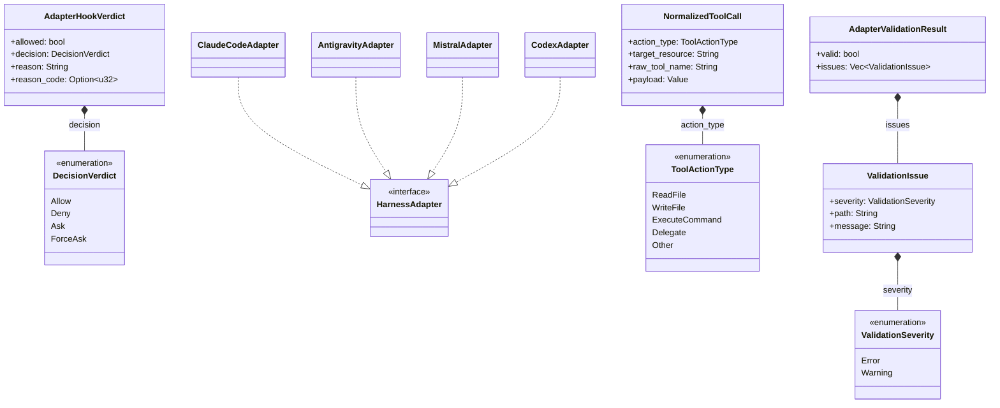

# Feature Architecture: `adapters`

🌐 **[Open Interactive Diagram (Mermaid Live)](https://mermaid.live/view#base64:eyJjb2RlIjoiY2xhc3NEaWFncmFtXG4gICAgZGlyZWN0aW9uIFRCXG5cbiAgICAlJSA9PT09PT09PT09PT09PT09PT09PT09PT09PT09PT09PT09PT09PT09PT09PT09PT09PT09PT09PT09PT09PT09PT09PVxuICAgICUlIPCfp6kgRmVhdHVyZSBTbGljZTogYWRhcHRlcnMgKHdpdGggMS1ob3AgZG9tYWluIG5laWdoYm9ycylcbiAgICAlJSA9PT09PT09PT09PT09PT09PT09PT09PT09PT09PT09PT09PT09PT09PT09PT09PT09PT09PT09PT09PT09PT09PT09PVxuXG4gICAgY2xhc3MgQWRhcHRlckhvb2tWZXJkaWN0IHtcbiAgICAgICAgK2FsbG93ZWQ6IGJvb2xcbiAgICAgICAgK2RlY2lzaW9uOiBEZWNpc2lvblZlcmRpY3RcbiAgICAgICAgK3JlYXNvbjogU3RyaW5nXG4gICAgICAgICtyZWFzb25fY29kZTogT3B0aW9ufnUzMn5cbiAgICB9XG5cbiAgICBjbGFzcyBBZGFwdGVyVmFsaWRhdGlvblJlc3VsdCB7XG4gICAgICAgICt2YWxpZDogYm9vbFxuICAgICAgICAraXNzdWVzOiBWZWN+VmFsaWRhdGlvbklzc3VlflxuICAgIH1cblxuICAgIGNsYXNzIEFudGlncmF2aXR5QWRhcHRlciB7XG4gICAgfVxuXG4gICAgY2xhc3MgQ2xhdWRlQ29kZUFkYXB0ZXIge1xuICAgIH1cblxuICAgIGNsYXNzIENvZGV4QWRhcHRlciB7XG4gICAgfVxuXG4gICAgY2xhc3MgRGVjaXNpb25WZXJkaWN0IHtcbiAgICAgICAgPDxlbnVtZXJhdGlvbj4+XG4gICAgICAgIEFsbG93XG4gICAgICAgIERlbnlcbiAgICAgICAgQXNrXG4gICAgICAgIEZvcmNlQXNrXG4gICAgfVxuXG4gICAgY2xhc3MgSGFybmVzc0FkYXB0ZXIge1xuICAgICAgICA8PGludGVyZmFjZT4+XG4gICAgfVxuXG4gICAgY2xhc3MgTWlzdHJhbEFkYXB0ZXIge1xuICAgIH1cblxuICAgIGNsYXNzIE5vcm1hbGl6ZWRUb29sQ2FsbCB7XG4gICAgICAgICthY3Rpb25fdHlwZTogVG9vbEFjdGlvblR5cGVcbiAgICAgICAgK3RhcmdldF9yZXNvdXJjZTogU3RyaW5nXG4gICAgICAgICtyYXdfdG9vbF9uYW1lOiBTdHJpbmdcbiAgICAgICAgK3BheWxvYWQ6IFZhbHVlXG4gICAgfVxuXG4gICAgY2xhc3MgVG9vbEFjdGlvblR5cGUge1xuICAgICAgICA8PGVudW1lcmF0aW9uPj5cbiAgICAgICAgUmVhZEZpbGVcbiAgICAgICAgV3JpdGVGaWxlXG4gICAgICAgIEV4ZWN1dGVDb21tYW5kXG4gICAgICAgIERlbGVnYXRlXG4gICAgICAgIE90aGVyXG4gICAgfVxuXG4gICAgY2xhc3MgVmFsaWRhdGlvbklzc3VlIHtcbiAgICAgICAgK3NldmVyaXR5OiBWYWxpZGF0aW9uU2V2ZXJpdHlcbiAgICAgICAgK3BhdGg6IFN0cmluZ1xuICAgICAgICArbWVzc2FnZTogU3RyaW5nXG4gICAgfVxuXG4gICAgY2xhc3MgVmFsaWRhdGlvblNldmVyaXR5IHtcbiAgICAgICAgPDxlbnVtZXJhdGlvbj4+XG4gICAgICAgIEVycm9yXG4gICAgICAgIFdhcm5pbmdcbiAgICB9XG5cbiAgICBDbGF1ZGVDb2RlQWRhcHRlciAuLnw+IEhhcm5lc3NBZGFwdGVyXG4gICAgQW50aWdyYXZpdHlBZGFwdGVyIC4ufD4gSGFybmVzc0FkYXB0ZXJcbiAgICBNaXN0cmFsQWRhcHRlciAuLnw+IEhhcm5lc3NBZGFwdGVyXG4gICAgQ29kZXhBZGFwdGVyIC4ufD4gSGFybmVzc0FkYXB0ZXJcbiAgICBBZGFwdGVyVmFsaWRhdGlvblJlc3VsdCAqLS0gVmFsaWRhdGlvbklzc3VlIDogaXNzdWVzXG4gICAgVmFsaWRhdGlvbklzc3VlICotLSBWYWxpZGF0aW9uU2V2ZXJpdHkgOiBzZXZlcml0eVxuICAgIE5vcm1hbGl6ZWRUb29sQ2FsbCAqLS0gVG9vbEFjdGlvblR5cGUgOiBhY3Rpb25fdHlwZVxuICAgIEFkYXB0ZXJIb29rVmVyZGljdCAqLS0gRGVjaXNpb25WZXJkaWN0IDogZGVjaXNpb24iLCJtZXJtYWlkIjp7InRoZW1lIjoiZGVmYXVsdCJ9LCJhdXRvU3luYyI6dHJ1ZSwidXBkYXRlRWRpdG9yIjpmYWxzZX0=)** • ← [Full Architecture](../../architecture.md) • 📋 [Feature Spec](../../specs/adapters.md)

> Scoped domænemodel for `adapters` (inkl. direkte 1-hop naborelationer). Åbn lokalt med pan/zoom via `xgauntlet topology open --feature adapters`.

