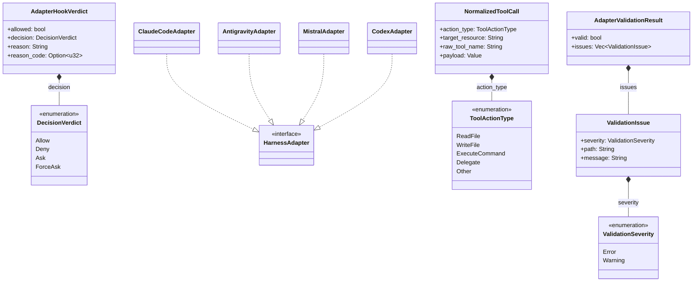

# Feature Architecture: `adapters`

🌐 **[Open Interactive Diagram (Pele Playground)](https://pele.run/playground#source=classDiagram%0A++++direction+TB%0A%0A++++%25%25+%3D%3D%3D%3D%3D%3D%3D%3D%3D%3D%3D%3D%3D%3D%3D%3D%3D%3D%3D%3D%3D%3D%3D%3D%3D%3D%3D%3D%3D%3D%3D%3D%3D%3D%3D%3D%3D%3D%3D%3D%3D%3D%3D%3D%3D%3D%3D%3D%3D%3D%3D%3D%3D%3D%3D%3D%3D%3D%3D%3D%3D%3D%3D%3D%3D%3D%3D%3D%0A++++%25%25+%F0%9F%A7%A9+Feature+Slice%3A+adapters+%28with+1-hop+domain+neighbors%29%0A++++%25%25+%3D%3D%3D%3D%3D%3D%3D%3D%3D%3D%3D%3D%3D%3D%3D%3D%3D%3D%3D%3D%3D%3D%3D%3D%3D%3D%3D%3D%3D%3D%3D%3D%3D%3D%3D%3D%3D%3D%3D%3D%3D%3D%3D%3D%3D%3D%3D%3D%3D%3D%3D%3D%3D%3D%3D%3D%3D%3D%3D%3D%3D%3D%3D%3D%3D%3D%3D%3D%0A%0A++++class+AdapterHookVerdict+%7B%0A++++++++%2Ballowed%3A+bool%0A++++++++%2Bdecision%3A+DecisionVerdict%0A++++++++%2Breason%3A+String%0A++++++++%2Breason_code%3A+Option%7Eu32%7E%0A++++%7D%0A%0A++++class+AdapterValidationResult+%7B%0A++++++++%2Bvalid%3A+bool%0A++++++++%2Bissues%3A+Vec%7EValidationIssue%7E%0A++++%7D%0A%0A++++class+AntigravityAdapter+%7B%0A++++%7D%0A%0A++++class+ClaudeCodeAdapter+%7B%0A++++%7D%0A%0A++++class+CodexAdapter+%7B%0A++++%7D%0A%0A++++class+DecisionVerdict+%7B%0A++++++++%3C%3Cenumeration%3E%3E%0A++++++++Allow%0A++++++++Deny%0A++++++++Ask%0A++++++++ForceAsk%0A++++%7D%0A%0A++++class+HarnessAdapter+%7B%0A++++++++%3C%3Cinterface%3E%3E%0A++++%7D%0A%0A++++class+MistralAdapter+%7B%0A++++%7D%0A%0A++++class+NormalizedToolCall+%7B%0A++++++++%2Baction_type%3A+ToolActionType%0A++++++++%2Btarget_resource%3A+String%0A++++++++%2Braw_tool_name%3A+String%0A++++++++%2Bpayload%3A+Value%0A++++%7D%0A%0A++++class+ToolActionType+%7B%0A++++++++%3C%3Cenumeration%3E%3E%0A++++++++ReadFile%0A++++++++WriteFile%0A++++++++ExecuteCommand%0A++++++++Delegate%0A++++++++Other%0A++++%7D%0A%0A++++class+ValidationIssue+%7B%0A++++++++%2Bseverity%3A+ValidationSeverity%0A++++++++%2Bpath%3A+String%0A++++++++%2Bmessage%3A+String%0A++++%7D%0A%0A++++class+ValidationSeverity+%7B%0A++++++++%3C%3Cenumeration%3E%3E%0A++++++++Error%0A++++++++Warning%0A++++%7D%0A%0A++++ClaudeCodeAdapter+..%7C%3E+HarnessAdapter%0A++++AntigravityAdapter+..%7C%3E+HarnessAdapter%0A++++MistralAdapter+..%7C%3E+HarnessAdapter%0A++++CodexAdapter+..%7C%3E+HarnessAdapter%0A++++ValidationIssue+*--+ValidationSeverity+%3A+severity%0A++++NormalizedToolCall+*--+ToolActionType+%3A+action_type%0A++++AdapterHookVerdict+*--+DecisionVerdict+%3A+decision%0A++++AdapterValidationResult+*--+ValidationIssue+%3A+issues)** • ← [Full Architecture](../../architecture.md) • 📋 [Feature Spec](../../specs/adapters.md)

> Scoped domænemodel for `adapters` (inkl. direkte 1-hop naborelationer). Åbn lokalt med pan/zoom via `xgauntlet topology open --feature adapters`.

