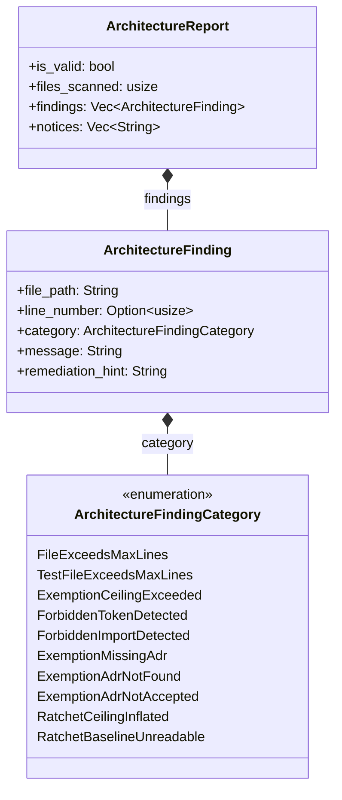

# Feature Architecture: `architecture`

🌐 **[Open Interactive Diagram (Mermaid Live)](https://mermaid.live/view#base64:eyJjb2RlIjoiY2xhc3NEaWFncmFtXG4gICAgZGlyZWN0aW9uIFRCXG5cbiAgICAlJSA9PT09PT09PT09PT09PT09PT09PT09PT09PT09PT09PT09PT09PT09PT09PT09PT09PT09PT09PT09PT09PT09PT09PVxuICAgICUlIPCfp6kgRmVhdHVyZSBTbGljZTogYXJjaGl0ZWN0dXJlICh3aXRoIDEtaG9wIGRvbWFpbiBuZWlnaGJvcnMpXG4gICAgJSUgPT09PT09PT09PT09PT09PT09PT09PT09PT09PT09PT09PT09PT09PT09PT09PT09PT09PT09PT09PT09PT09PT09PT1cblxuICAgIGNsYXNzIEFyY2hpdGVjdHVyZUZpbmRpbmcge1xuICAgICAgICArZmlsZV9wYXRoOiBTdHJpbmdcbiAgICAgICAgK2xpbmVfbnVtYmVyOiBPcHRpb25+dXNpemV+XG4gICAgICAgICtjYXRlZ29yeTogQXJjaGl0ZWN0dXJlRmluZGluZ0NhdGVnb3J5XG4gICAgICAgICttZXNzYWdlOiBTdHJpbmdcbiAgICAgICAgK3JlbWVkaWF0aW9uX2hpbnQ6IFN0cmluZ1xuICAgIH1cblxuICAgIGNsYXNzIEFyY2hpdGVjdHVyZUZpbmRpbmdDYXRlZ29yeSB7XG4gICAgICAgIDw8ZW51bWVyYXRpb24+PlxuICAgICAgICBGaWxlRXhjZWVkc01heExpbmVzXG4gICAgICAgIFRlc3RGaWxlRXhjZWVkc01heExpbmVzXG4gICAgICAgIEV4ZW1wdGlvbkNlaWxpbmdFeGNlZWRlZFxuICAgICAgICBGb3JiaWRkZW5Ub2tlbkRldGVjdGVkXG4gICAgICAgIEZvcmJpZGRlbkltcG9ydERldGVjdGVkXG4gICAgICAgIEV4ZW1wdGlvbk1pc3NpbmdBZHJcbiAgICAgICAgRXhlbXB0aW9uQWRyTm90Rm91bmRcbiAgICAgICAgRXhlbXB0aW9uQWRyTm90QWNjZXB0ZWRcbiAgICAgICAgUmF0Y2hldENlaWxpbmdJbmZsYXRlZFxuICAgICAgICBSYXRjaGV0QmFzZWxpbmVVbnJlYWRhYmxlXG4gICAgfVxuXG4gICAgY2xhc3MgQXJjaGl0ZWN0dXJlUmVwb3J0IHtcbiAgICAgICAgK2lzX3ZhbGlkOiBib29sXG4gICAgICAgICtmaWxlc19zY2FubmVkOiB1c2l6ZVxuICAgICAgICArZmluZGluZ3M6IFZlY35BcmNoaXRlY3R1cmVGaW5kaW5nflxuICAgICAgICArbm90aWNlczogVmVjflN0cmluZ35cbiAgICB9XG5cbiAgICBBcmNoaXRlY3R1cmVGaW5kaW5nICotLSBBcmNoaXRlY3R1cmVGaW5kaW5nQ2F0ZWdvcnkgOiBjYXRlZ29yeVxuICAgIEFyY2hpdGVjdHVyZVJlcG9ydCAqLS0gQXJjaGl0ZWN0dXJlRmluZGluZyA6IGZpbmRpbmdzIiwibWVybWFpZCI6eyJ0aGVtZSI6ImRlZmF1bHQifSwiYXV0b1N5bmMiOnRydWUsInVwZGF0ZUVkaXRvciI6ZmFsc2V9)** • ← [Full Architecture](../../architecture.md) • 📋 [Feature Spec](../../specs/architecture.md)

> Scoped domænemodel for `architecture` (inkl. direkte 1-hop naborelationer). Åbn lokalt med pan/zoom via `xgauntlet topology open --feature architecture`.

