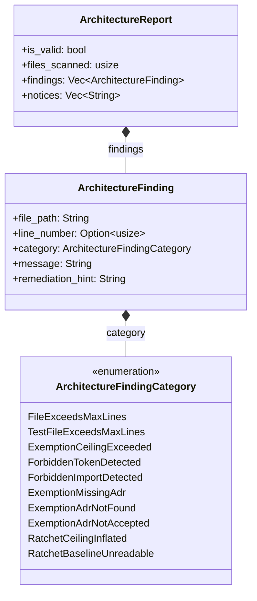

# Feature Architecture: `architecture`

🌐 **[Open Interactive Diagram (Pele Playground)](https://pele.run/playground#source=classDiagram%0A++++direction+TB%0A%0A++++%25%25+%3D%3D%3D%3D%3D%3D%3D%3D%3D%3D%3D%3D%3D%3D%3D%3D%3D%3D%3D%3D%3D%3D%3D%3D%3D%3D%3D%3D%3D%3D%3D%3D%3D%3D%3D%3D%3D%3D%3D%3D%3D%3D%3D%3D%3D%3D%3D%3D%3D%3D%3D%3D%3D%3D%3D%3D%3D%3D%3D%3D%3D%3D%3D%3D%3D%3D%3D%3D%0A++++%25%25+%F0%9F%A7%A9+Feature+Slice%3A+architecture+%28with+1-hop+domain+neighbors%29%0A++++%25%25+%3D%3D%3D%3D%3D%3D%3D%3D%3D%3D%3D%3D%3D%3D%3D%3D%3D%3D%3D%3D%3D%3D%3D%3D%3D%3D%3D%3D%3D%3D%3D%3D%3D%3D%3D%3D%3D%3D%3D%3D%3D%3D%3D%3D%3D%3D%3D%3D%3D%3D%3D%3D%3D%3D%3D%3D%3D%3D%3D%3D%3D%3D%3D%3D%3D%3D%3D%3D%0A%0A++++class+ArchitectureFinding+%7B%0A++++++++%2Bfile_path%3A+String%0A++++++++%2Bline_number%3A+Option%7Eusize%7E%0A++++++++%2Bcategory%3A+ArchitectureFindingCategory%0A++++++++%2Bmessage%3A+String%0A++++++++%2Bremediation_hint%3A+String%0A++++%7D%0A%0A++++class+ArchitectureFindingCategory+%7B%0A++++++++%3C%3Cenumeration%3E%3E%0A++++++++FileExceedsMaxLines%0A++++++++TestFileExceedsMaxLines%0A++++++++ExemptionCeilingExceeded%0A++++++++ForbiddenTokenDetected%0A++++++++ForbiddenImportDetected%0A++++++++ExemptionMissingAdr%0A++++++++ExemptionAdrNotFound%0A++++++++ExemptionAdrNotAccepted%0A++++++++RatchetCeilingInflated%0A++++++++RatchetBaselineUnreadable%0A++++%7D%0A%0A++++class+ArchitectureReport+%7B%0A++++++++%2Bis_valid%3A+bool%0A++++++++%2Bfiles_scanned%3A+usize%0A++++++++%2Bfindings%3A+Vec%7EArchitectureFinding%7E%0A++++++++%2Bnotices%3A+Vec%7EString%7E%0A++++%7D%0A%0A++++ArchitectureReport+*--+ArchitectureFinding+%3A+findings%0A++++ArchitectureFinding+*--+ArchitectureFindingCategory+%3A+category)** • ← [Full Architecture](../../architecture.md) • 📋 [Feature Spec](../../specs/architecture.md)

> Scoped domænemodel for `architecture` (inkl. direkte 1-hop naborelationer). Åbn lokalt med pan/zoom via `xgauntlet topology open --feature architecture`.

