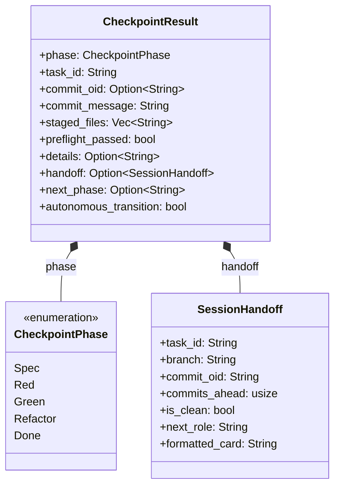

# Feature Architecture: `checkpoint`

🌐 **[Open Interactive Diagram (Mermaid Live)](https://mermaid.live/view#base64:eyJjb2RlIjoiY2xhc3NEaWFncmFtXG4gICAgZGlyZWN0aW9uIFRCXG5cbiAgICAlJSA9PT09PT09PT09PT09PT09PT09PT09PT09PT09PT09PT09PT09PT09PT09PT09PT09PT09PT09PT09PT09PT09PT09PVxuICAgICUlIPCfp6kgRmVhdHVyZSBTbGljZTogY2hlY2twb2ludCAod2l0aCAxLWhvcCBkb21haW4gbmVpZ2hib3JzKVxuICAgICUlID09PT09PT09PT09PT09PT09PT09PT09PT09PT09PT09PT09PT09PT09PT09PT09PT09PT09PT09PT09PT09PT09PT09XG5cbiAgICBjbGFzcyBDaGVja3BvaW50UGhhc2Uge1xuICAgICAgICA8PGVudW1lcmF0aW9uPj5cbiAgICAgICAgU3BlY1xuICAgICAgICBSZWRcbiAgICAgICAgR3JlZW5cbiAgICAgICAgUmVmYWN0b3JcbiAgICAgICAgRG9uZVxuICAgIH1cblxuICAgIGNsYXNzIENoZWNrcG9pbnRSZXN1bHQge1xuICAgICAgICArcGhhc2U6IENoZWNrcG9pbnRQaGFzZVxuICAgICAgICArdGFza19pZDogU3RyaW5nXG4gICAgICAgICtjb21taXRfb2lkOiBPcHRpb25+U3RyaW5nflxuICAgICAgICArY29tbWl0X21lc3NhZ2U6IFN0cmluZ1xuICAgICAgICArc3RhZ2VkX2ZpbGVzOiBWZWN+U3RyaW5nflxuICAgICAgICArcHJlZmxpZ2h0X3Bhc3NlZDogYm9vbFxuICAgICAgICArZGV0YWlsczogT3B0aW9uflN0cmluZ35cbiAgICAgICAgK2hhbmRvZmY6IE9wdGlvbn5TZXNzaW9uSGFuZG9mZn5cbiAgICAgICAgK25leHRfcGhhc2U6IE9wdGlvbn5TdHJpbmd+XG4gICAgICAgICthdXRvbm9tb3VzX3RyYW5zaXRpb246IGJvb2xcbiAgICB9XG5cbiAgICBjbGFzcyBTZXNzaW9uSGFuZG9mZiB7XG4gICAgICAgICt0YXNrX2lkOiBTdHJpbmdcbiAgICAgICAgK2JyYW5jaDogU3RyaW5nXG4gICAgICAgICtjb21taXRfb2lkOiBTdHJpbmdcbiAgICAgICAgK2NvbW1pdHNfYWhlYWQ6IHVzaXplXG4gICAgICAgICtpc19jbGVhbjogYm9vbFxuICAgICAgICArbmV4dF9yb2xlOiBTdHJpbmdcbiAgICAgICAgK2Zvcm1hdHRlZF9jYXJkOiBTdHJpbmdcbiAgICB9XG5cbiAgICBDaGVja3BvaW50UmVzdWx0ICotLSBDaGVja3BvaW50UGhhc2UgOiBwaGFzZVxuICAgIENoZWNrcG9pbnRSZXN1bHQgKi0tIFNlc3Npb25IYW5kb2ZmIDogaGFuZG9mZiIsIm1lcm1haWQiOnsidGhlbWUiOiJkZWZhdWx0In0sImF1dG9TeW5jIjp0cnVlLCJ1cGRhdGVFZGl0b3IiOmZhbHNlfQ==)** • ← [Full Architecture](../../architecture.md) • 📋 [Feature Spec](../../specs/checkpoint.md)

> Scoped domænemodel for `checkpoint` (inkl. direkte 1-hop naborelationer). Åbn lokalt med pan/zoom via `xgauntlet topology open --feature checkpoint`.

