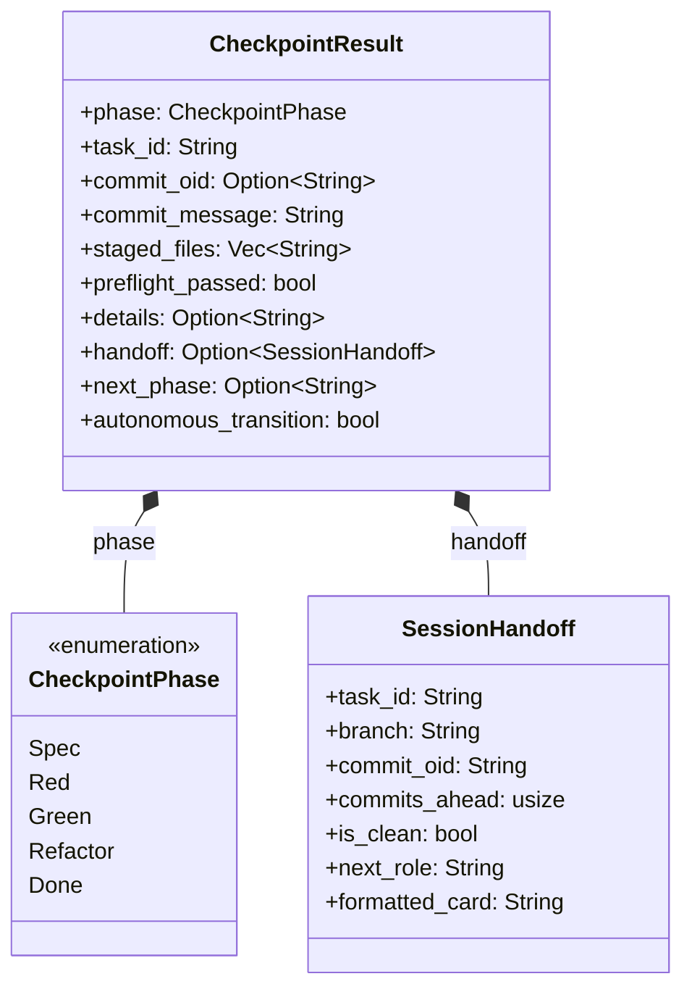

# Feature Architecture: `checkpoint`

🌐 **[Open Interactive Diagram (Pele Playground)](https://pele.run/playground#source=classDiagram%0A++++direction+TB%0A%0A++++%25%25+%3D%3D%3D%3D%3D%3D%3D%3D%3D%3D%3D%3D%3D%3D%3D%3D%3D%3D%3D%3D%3D%3D%3D%3D%3D%3D%3D%3D%3D%3D%3D%3D%3D%3D%3D%3D%3D%3D%3D%3D%3D%3D%3D%3D%3D%3D%3D%3D%3D%3D%3D%3D%3D%3D%3D%3D%3D%3D%3D%3D%3D%3D%3D%3D%3D%3D%3D%3D%0A++++%25%25+%F0%9F%A7%A9+Feature+Slice%3A+checkpoint+%28with+1-hop+domain+neighbors%29%0A++++%25%25+%3D%3D%3D%3D%3D%3D%3D%3D%3D%3D%3D%3D%3D%3D%3D%3D%3D%3D%3D%3D%3D%3D%3D%3D%3D%3D%3D%3D%3D%3D%3D%3D%3D%3D%3D%3D%3D%3D%3D%3D%3D%3D%3D%3D%3D%3D%3D%3D%3D%3D%3D%3D%3D%3D%3D%3D%3D%3D%3D%3D%3D%3D%3D%3D%3D%3D%3D%3D%0A%0A++++class+CheckpointPhase+%7B%0A++++++++%3C%3Cenumeration%3E%3E%0A++++++++Spec%0A++++++++Red%0A++++++++Green%0A++++++++Refactor%0A++++++++Done%0A++++%7D%0A%0A++++class+CheckpointResult+%7B%0A++++++++%2Bphase%3A+CheckpointPhase%0A++++++++%2Btask_id%3A+String%0A++++++++%2Bcommit_oid%3A+Option%7EString%7E%0A++++++++%2Bcommit_message%3A+String%0A++++++++%2Bstaged_files%3A+Vec%7EString%7E%0A++++++++%2Bpreflight_passed%3A+bool%0A++++++++%2Bdetails%3A+Option%7EString%7E%0A++++++++%2Bhandoff%3A+Option%7ESessionHandoff%7E%0A++++++++%2Bnext_phase%3A+Option%7EString%7E%0A++++++++%2Bautonomous_transition%3A+bool%0A++++%7D%0A%0A++++class+SessionHandoff+%7B%0A++++++++%2Btask_id%3A+String%0A++++++++%2Bbranch%3A+String%0A++++++++%2Bcommit_oid%3A+String%0A++++++++%2Bcommits_ahead%3A+usize%0A++++++++%2Bis_clean%3A+bool%0A++++++++%2Bnext_role%3A+String%0A++++++++%2Bformatted_card%3A+String%0A++++%7D%0A%0A++++CheckpointResult+*--+CheckpointPhase+%3A+phase%0A++++CheckpointResult+*--+SessionHandoff+%3A+handoff)** • ← [Full Architecture](../../architecture.md) • 📋 [Feature Spec](../../specs/checkpoint.md)

> Scoped domænemodel for `checkpoint` (inkl. direkte 1-hop naborelationer). Åbn lokalt med pan/zoom via `xgauntlet topology open --feature checkpoint`.

