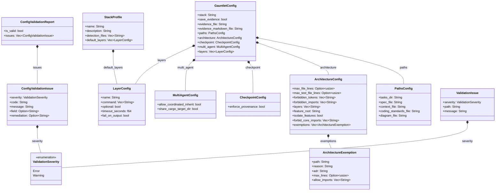

# Feature Architecture: `config`

🌐 **[Open Interactive Diagram (Mermaid Live)](https://mermaid.live/view#base64:eyJjb2RlIjoiY2xhc3NEaWFncmFtXG4gICAgZGlyZWN0aW9uIFRCXG5cbiAgICAlJSA9PT09PT09PT09PT09PT09PT09PT09PT09PT09PT09PT09PT09PT09PT09PT09PT09PT09PT09PT09PT09PT09PT09PVxuICAgICUlIPCfp6kgRmVhdHVyZSBTbGljZTogY29uZmlnICh3aXRoIDEtaG9wIGRvbWFpbiBuZWlnaGJvcnMpXG4gICAgJSUgPT09PT09PT09PT09PT09PT09PT09PT09PT09PT09PT09PT09PT09PT09PT09PT09PT09PT09PT09PT09PT09PT09PT1cblxuICAgIGNsYXNzIEFyY2hpdGVjdHVyZUNvbmZpZyB7XG4gICAgICAgICttYXhfZmlsZV9saW5lczogT3B0aW9ufnVzaXplflxuICAgICAgICArbWF4X3Rlc3RfZmlsZV9saW5lczogT3B0aW9ufnVzaXplflxuICAgICAgICArZm9yYmlkZGVuX3Rva2VuczogVmVjflN0cmluZ35cbiAgICAgICAgK2ZvcmJpZGRlbl9pbXBvcnRzOiBWZWN+U3RyaW5nflxuICAgICAgICArbGF5ZXJzOiBWZWN+U3RyaW5nflxuICAgICAgICArZmVhdHVyZV9yb290OiBTdHJpbmdcbiAgICAgICAgK2lzb2xhdGVfZmVhdHVyZXM6IGJvb2xcbiAgICAgICAgK2ZvcmJpZF9jb3JlX2ltcG9ydHM6IFZlY35TdHJpbmd+XG4gICAgICAgICtleGVtcHRpb25zOiBWZWN+QXJjaGl0ZWN0dXJlRXhlbXB0aW9uflxuICAgIH1cblxuICAgIGNsYXNzIEFyY2hpdGVjdHVyZUV4ZW1wdGlvbiB7XG4gICAgICAgICtwYXRoOiBTdHJpbmdcbiAgICAgICAgK3JlYXNvbjogU3RyaW5nXG4gICAgICAgICthZHI6IFN0cmluZ1xuICAgICAgICArbWF4X2xpbmVzOiBPcHRpb25+dXNpemV+XG4gICAgICAgICthbGxvd19pbXBvcnRzOiBWZWN+U3RyaW5nflxuICAgIH1cblxuICAgIGNsYXNzIENoZWNrcG9pbnRDb25maWcge1xuICAgICAgICArZW5mb3JjZV9wcm92ZW5hbmNlOiBib29sXG4gICAgfVxuXG4gICAgY2xhc3MgQ29uZmlnVmFsaWRhdGlvbklzc3VlIHtcbiAgICAgICAgK3NldmVyaXR5OiBWYWxpZGF0aW9uU2V2ZXJpdHlcbiAgICAgICAgK2NvZGU6IFN0cmluZ1xuICAgICAgICArbWVzc2FnZTogU3RyaW5nXG4gICAgICAgICtmaWVsZDogT3B0aW9uflN0cmluZ35cbiAgICAgICAgK3JlbWVkaWF0aW9uOiBPcHRpb25+U3RyaW5nflxuICAgIH1cblxuICAgIGNsYXNzIENvbmZpZ1ZhbGlkYXRpb25SZXBvcnQge1xuICAgICAgICAraXNfdmFsaWQ6IGJvb2xcbiAgICAgICAgK2lzc3VlczogVmVjfkNvbmZpZ1ZhbGlkYXRpb25Jc3N1ZX5cbiAgICB9XG5cbiAgICBjbGFzcyBHYXVudGxldENvbmZpZyB7XG4gICAgICAgICtzdGFjazogU3RyaW5nXG4gICAgICAgICtzYXZlX2V2aWRlbmNlOiBib29sXG4gICAgICAgICtldmlkZW5jZV9maWxlOiBTdHJpbmdcbiAgICAgICAgK2V2aWRlbmNlX21hcmtkb3duX2ZpbGU6IFN0cmluZ1xuICAgICAgICArcGF0aHM6IFBhdGhzQ29uZmlnXG4gICAgICAgICthcmNoaXRlY3R1cmU6IEFyY2hpdGVjdHVyZUNvbmZpZ1xuICAgICAgICArY2hlY2twb2ludDogQ2hlY2twb2ludENvbmZpZ1xuICAgICAgICArbXVsdGlfYWdlbnQ6IE11bHRpQWdlbnRDb25maWdcbiAgICAgICAgK2xheWVyczogVmVjfkxheWVyQ29uZmlnflxuICAgIH1cblxuICAgIGNsYXNzIExheWVyQ29uZmlnIHtcbiAgICAgICAgK25hbWU6IFN0cmluZ1xuICAgICAgICArY29tbWFuZDogVmVjflN0cmluZ35cbiAgICAgICAgK29wdGlvbmFsOiBib29sXG4gICAgICAgICt0aW1lb3V0X3NlY29uZHM6IGY2NFxuICAgICAgICArZmFpbF9vbl9vdXRwdXQ6IGJvb2xcbiAgICB9XG5cbiAgICBjbGFzcyBNdWx0aUFnZW50Q29uZmlnIHtcbiAgICAgICAgK2FsbG93X2Nvb3JkaW5hdGVkX2luaGVyaXQ6IGJvb2xcbiAgICAgICAgK3NoYXJlX2NhcmdvX3RhcmdldF9kaXI6IGJvb2xcbiAgICB9XG5cbiAgICBjbGFzcyBQYXRoc0NvbmZpZyB7XG4gICAgICAgICt0YXNrc19kaXI6IFN0cmluZ1xuICAgICAgICArc3BlY19maWxlOiBTdHJpbmdcbiAgICAgICAgK2NvbnRleHRfZmlsZTogU3RyaW5nXG4gICAgICAgICtjb2Rpbmdfc3RhbmRhcmRzX2ZpbGU6IFN0cmluZ1xuICAgICAgICArZGlhZ3JhbV9maWxlOiBTdHJpbmdcbiAgICB9XG5cbiAgICBjbGFzcyBTdGFja1Byb2ZpbGUge1xuICAgICAgICArbmFtZTogU3RyaW5nXG4gICAgICAgICtkZXNjcmlwdGlvbjogU3RyaW5nXG4gICAgICAgICtkZXRlY3Rpb25fZmlsZXM6IFZlY35TdHJpbmd+XG4gICAgICAgICtkZWZhdWx0X2xheWVyczogVmVjfkxheWVyQ29uZmlnflxuICAgIH1cblxuICAgIGNsYXNzIFZhbGlkYXRpb25Jc3N1ZSB7XG4gICAgICAgICtzZXZlcml0eTogVmFsaWRhdGlvblNldmVyaXR5XG4gICAgICAgICtwYXRoOiBTdHJpbmdcbiAgICAgICAgK21lc3NhZ2U6IFN0cmluZ1xuICAgIH1cblxuICAgIGNsYXNzIFZhbGlkYXRpb25TZXZlcml0eSB7XG4gICAgICAgIDw8ZW51bWVyYXRpb24+PlxuICAgICAgICBFcnJvclxuICAgICAgICBXYXJuaW5nXG4gICAgfVxuXG4gICAgVmFsaWRhdGlvbklzc3VlICotLSBWYWxpZGF0aW9uU2V2ZXJpdHkgOiBzZXZlcml0eVxuICAgIEdhdW50bGV0Q29uZmlnICotLSBQYXRoc0NvbmZpZyA6IHBhdGhzXG4gICAgR2F1bnRsZXRDb25maWcgKi0tIEFyY2hpdGVjdHVyZUNvbmZpZyA6IGFyY2hpdGVjdHVyZVxuICAgIEdhdW50bGV0Q29uZmlnICotLSBDaGVja3BvaW50Q29uZmlnIDogY2hlY2twb2ludFxuICAgIEdhdW50bGV0Q29uZmlnICotLSBNdWx0aUFnZW50Q29uZmlnIDogbXVsdGlfYWdlbnRcbiAgICBHYXVudGxldENvbmZpZyAqLS0gTGF5ZXJDb25maWcgOiBsYXllcnNcbiAgICBBcmNoaXRlY3R1cmVDb25maWcgKi0tIEFyY2hpdGVjdHVyZUV4ZW1wdGlvbiA6IGV4ZW1wdGlvbnNcbiAgICBDb25maWdWYWxpZGF0aW9uSXNzdWUgKi0tIFZhbGlkYXRpb25TZXZlcml0eSA6IHNldmVyaXR5XG4gICAgQ29uZmlnVmFsaWRhdGlvblJlcG9ydCAqLS0gQ29uZmlnVmFsaWRhdGlvbklzc3VlIDogaXNzdWVzXG4gICAgU3RhY2tQcm9maWxlICotLSBMYXllckNvbmZpZyA6IGRlZmF1bHRfbGF5ZXJzIiwibWVybWFpZCI6eyJ0aGVtZSI6ImRlZmF1bHQifSwiYXV0b1N5bmMiOnRydWUsInVwZGF0ZUVkaXRvciI6ZmFsc2V9)** • ← [Full Architecture](../../architecture.md) • 📋 [Feature Spec](../../specs/config.md)

> Scoped domænemodel for `config` (inkl. direkte 1-hop naborelationer). Åbn lokalt med pan/zoom via `xgauntlet topology open --feature config`.

