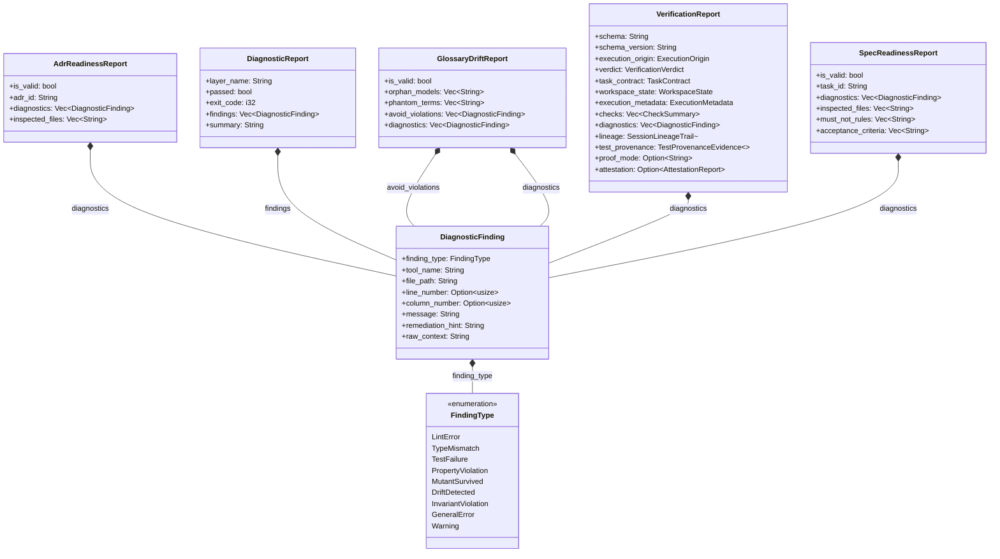

# Feature Architecture: `diagnostics`

🌐 **[Open Interactive Diagram (Mermaid Live)](https://mermaid.live/view#base64:eyJjb2RlIjoiY2xhc3NEaWFncmFtXG4gICAgZGlyZWN0aW9uIFRCXG5cbiAgICAlJSA9PT09PT09PT09PT09PT09PT09PT09PT09PT09PT09PT09PT09PT09PT09PT09PT09PT09PT09PT09PT09PT09PT09PVxuICAgICUlIPCfp6kgRmVhdHVyZSBTbGljZTogZGlhZ25vc3RpY3MgKHdpdGggMS1ob3AgZG9tYWluIG5laWdoYm9ycylcbiAgICAlJSA9PT09PT09PT09PT09PT09PT09PT09PT09PT09PT09PT09PT09PT09PT09PT09PT09PT09PT09PT09PT09PT09PT09PVxuXG4gICAgY2xhc3MgQWRyUmVhZGluZXNzUmVwb3J0IHtcbiAgICAgICAgK2lzX3ZhbGlkOiBib29sXG4gICAgICAgICthZHJfaWQ6IFN0cmluZ1xuICAgICAgICArZGlhZ25vc3RpY3M6IFZlY35EaWFnbm9zdGljRmluZGluZ35cbiAgICAgICAgK2luc3BlY3RlZF9maWxlczogVmVjflN0cmluZ35cbiAgICB9XG5cbiAgICBjbGFzcyBEaWFnbm9zdGljRmluZGluZyB7XG4gICAgICAgICtmaW5kaW5nX3R5cGU6IEZpbmRpbmdUeXBlXG4gICAgICAgICt0b29sX25hbWU6IFN0cmluZ1xuICAgICAgICArZmlsZV9wYXRoOiBTdHJpbmdcbiAgICAgICAgK2xpbmVfbnVtYmVyOiBPcHRpb25+dXNpemV+XG4gICAgICAgICtjb2x1bW5fbnVtYmVyOiBPcHRpb25+dXNpemV+XG4gICAgICAgICttZXNzYWdlOiBTdHJpbmdcbiAgICAgICAgK3JlbWVkaWF0aW9uX2hpbnQ6IFN0cmluZ1xuICAgICAgICArcmF3X2NvbnRleHQ6IFN0cmluZ1xuICAgIH1cblxuICAgIGNsYXNzIERpYWdub3N0aWNSZXBvcnQge1xuICAgICAgICArbGF5ZXJfbmFtZTogU3RyaW5nXG4gICAgICAgICtwYXNzZWQ6IGJvb2xcbiAgICAgICAgK2V4aXRfY29kZTogaTMyXG4gICAgICAgICtmaW5kaW5nczogVmVjfkRpYWdub3N0aWNGaW5kaW5nflxuICAgICAgICArc3VtbWFyeTogU3RyaW5nXG4gICAgfVxuXG4gICAgY2xhc3MgRmluZGluZ1R5cGUge1xuICAgICAgICA8PGVudW1lcmF0aW9uPj5cbiAgICAgICAgTGludEVycm9yXG4gICAgICAgIFR5cGVNaXNtYXRjaFxuICAgICAgICBUZXN0RmFpbHVyZVxuICAgICAgICBQcm9wZXJ0eVZpb2xhdGlvblxuICAgICAgICBNdXRhbnRTdXJ2aXZlZFxuICAgICAgICBEcmlmdERldGVjdGVkXG4gICAgICAgIEludmFyaWFudFZpb2xhdGlvblxuICAgICAgICBHZW5lcmFsRXJyb3JcbiAgICAgICAgV2FybmluZ1xuICAgIH1cblxuICAgIGNsYXNzIEdsb3NzYXJ5RHJpZnRSZXBvcnQge1xuICAgICAgICAraXNfdmFsaWQ6IGJvb2xcbiAgICAgICAgK29ycGhhbl9tb2RlbHM6IFZlY35TdHJpbmd+XG4gICAgICAgICtwaGFudG9tX3Rlcm1zOiBWZWN+U3RyaW5nflxuICAgICAgICArYXZvaWRfdmlvbGF0aW9uczogVmVjfkRpYWdub3N0aWNGaW5kaW5nflxuICAgICAgICArZGlhZ25vc3RpY3M6IFZlY35EaWFnbm9zdGljRmluZGluZ35cbiAgICB9XG5cbiAgICBjbGFzcyBTcGVjUmVhZGluZXNzUmVwb3J0IHtcbiAgICAgICAgK2lzX3ZhbGlkOiBib29sXG4gICAgICAgICt0YXNrX2lkOiBTdHJpbmdcbiAgICAgICAgK2RpYWdub3N0aWNzOiBWZWN+RGlhZ25vc3RpY0ZpbmRpbmd+XG4gICAgICAgICtpbnNwZWN0ZWRfZmlsZXM6IFZlY35TdHJpbmd+XG4gICAgICAgICttdXN0X25vdF9ydWxlczogVmVjflN0cmluZ35cbiAgICAgICAgK2FjY2VwdGFuY2VfY3JpdGVyaWE6IFZlY35TdHJpbmd+XG4gICAgfVxuXG4gICAgY2xhc3MgVmVyaWZpY2F0aW9uUmVwb3J0IHtcbiAgICAgICAgK3NjaGVtYTogU3RyaW5nXG4gICAgICAgICtzY2hlbWFfdmVyc2lvbjogU3RyaW5nXG4gICAgICAgICtleGVjdXRpb25fb3JpZ2luOiBFeGVjdXRpb25PcmlnaW5cbiAgICAgICAgK3ZlcmRpY3Q6IFZlcmlmaWNhdGlvblZlcmRpY3RcbiAgICAgICAgK3Rhc2tfY29udHJhY3Q6IFRhc2tDb250cmFjdFxuICAgICAgICArd29ya3NwYWNlX3N0YXRlOiBXb3Jrc3BhY2VTdGF0ZVxuICAgICAgICArZXhlY3V0aW9uX21ldGFkYXRhOiBFeGVjdXRpb25NZXRhZGF0YVxuICAgICAgICArY2hlY2tzOiBWZWN+Q2hlY2tTdW1tYXJ5flxuICAgICAgICArZGlhZ25vc3RpY3M6IFZlY35EaWFnbm9zdGljRmluZGluZ35cbiAgICAgICAgK2xpbmVhZ2U6IFNlc3Npb25MaW5lYWdlVHJhaWx+XG4gICAgICAgICt0ZXN0X3Byb3ZlbmFuY2U6IFRlc3RQcm92ZW5hbmNlRXZpZGVuY2V+flxuICAgICAgICArcHJvb2ZfbW9kZTogT3B0aW9uflN0cmluZ35cbiAgICAgICAgK2F0dGVzdGF0aW9uOiBPcHRpb25+QXR0ZXN0YXRpb25SZXBvcnR+XG4gICAgfVxuXG4gICAgQWRyUmVhZGluZXNzUmVwb3J0ICotLSBEaWFnbm9zdGljRmluZGluZyA6IGRpYWdub3N0aWNzXG4gICAgRGlhZ25vc3RpY1JlcG9ydCAqLS0gRGlhZ25vc3RpY0ZpbmRpbmcgOiBmaW5kaW5nc1xuICAgIEdsb3NzYXJ5RHJpZnRSZXBvcnQgKi0tIERpYWdub3N0aWNGaW5kaW5nIDogYXZvaWRfdmlvbGF0aW9uc1xuICAgIEdsb3NzYXJ5RHJpZnRSZXBvcnQgKi0tIERpYWdub3N0aWNGaW5kaW5nIDogZGlhZ25vc3RpY3NcbiAgICBWZXJpZmljYXRpb25SZXBvcnQgKi0tIERpYWdub3N0aWNGaW5kaW5nIDogZGlhZ25vc3RpY3NcbiAgICBEaWFnbm9zdGljRmluZGluZyAqLS0gRmluZGluZ1R5cGUgOiBmaW5kaW5nX3R5cGVcbiAgICBTcGVjUmVhZGluZXNzUmVwb3J0ICotLSBEaWFnbm9zdGljRmluZGluZyA6IGRpYWdub3N0aWNzIiwibWVybWFpZCI6eyJ0aGVtZSI6ImRlZmF1bHQifSwiYXV0b1N5bmMiOnRydWUsInVwZGF0ZUVkaXRvciI6ZmFsc2V9)** • ← [Full Architecture](../../architecture.md) • 📋 [Feature Spec](../../specs/diagnostics.md)

> Scoped domænemodel for `diagnostics` (inkl. direkte 1-hop naborelationer). Åbn lokalt med pan/zoom via `xgauntlet topology open --feature diagnostics`.

