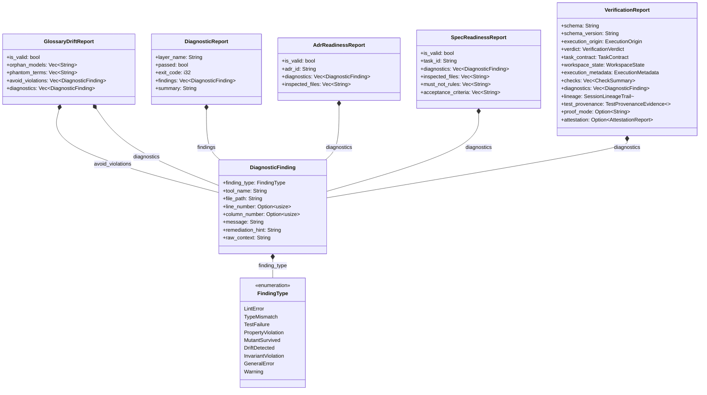

# Feature Architecture: `diagnostics`

🌐 **[Open Interactive Diagram (Pele Playground)](https://pele.run/playground#source=classDiagram%0A++++direction+TB%0A%0A++++%25%25+%3D%3D%3D%3D%3D%3D%3D%3D%3D%3D%3D%3D%3D%3D%3D%3D%3D%3D%3D%3D%3D%3D%3D%3D%3D%3D%3D%3D%3D%3D%3D%3D%3D%3D%3D%3D%3D%3D%3D%3D%3D%3D%3D%3D%3D%3D%3D%3D%3D%3D%3D%3D%3D%3D%3D%3D%3D%3D%3D%3D%3D%3D%3D%3D%3D%3D%3D%3D%0A++++%25%25+%F0%9F%A7%A9+Feature+Slice%3A+diagnostics+%28with+1-hop+domain+neighbors%29%0A++++%25%25+%3D%3D%3D%3D%3D%3D%3D%3D%3D%3D%3D%3D%3D%3D%3D%3D%3D%3D%3D%3D%3D%3D%3D%3D%3D%3D%3D%3D%3D%3D%3D%3D%3D%3D%3D%3D%3D%3D%3D%3D%3D%3D%3D%3D%3D%3D%3D%3D%3D%3D%3D%3D%3D%3D%3D%3D%3D%3D%3D%3D%3D%3D%3D%3D%3D%3D%3D%3D%0A%0A++++class+AdrReadinessReport+%7B%0A++++++++%2Bis_valid%3A+bool%0A++++++++%2Badr_id%3A+String%0A++++++++%2Bdiagnostics%3A+Vec%7EDiagnosticFinding%7E%0A++++++++%2Binspected_files%3A+Vec%7EString%7E%0A++++%7D%0A%0A++++class+DiagnosticFinding+%7B%0A++++++++%2Bfinding_type%3A+FindingType%0A++++++++%2Btool_name%3A+String%0A++++++++%2Bfile_path%3A+String%0A++++++++%2Bline_number%3A+Option%7Eusize%7E%0A++++++++%2Bcolumn_number%3A+Option%7Eusize%7E%0A++++++++%2Bmessage%3A+String%0A++++++++%2Bremediation_hint%3A+String%0A++++++++%2Braw_context%3A+String%0A++++%7D%0A%0A++++class+DiagnosticReport+%7B%0A++++++++%2Blayer_name%3A+String%0A++++++++%2Bpassed%3A+bool%0A++++++++%2Bexit_code%3A+i32%0A++++++++%2Bfindings%3A+Vec%7EDiagnosticFinding%7E%0A++++++++%2Bsummary%3A+String%0A++++%7D%0A%0A++++class+FindingType+%7B%0A++++++++%3C%3Cenumeration%3E%3E%0A++++++++LintError%0A++++++++TypeMismatch%0A++++++++TestFailure%0A++++++++PropertyViolation%0A++++++++MutantSurvived%0A++++++++DriftDetected%0A++++++++InvariantViolation%0A++++++++GeneralError%0A++++++++Warning%0A++++%7D%0A%0A++++class+GlossaryDriftReport+%7B%0A++++++++%2Bis_valid%3A+bool%0A++++++++%2Borphan_models%3A+Vec%7EString%7E%0A++++++++%2Bphantom_terms%3A+Vec%7EString%7E%0A++++++++%2Bavoid_violations%3A+Vec%7EDiagnosticFinding%7E%0A++++++++%2Bdiagnostics%3A+Vec%7EDiagnosticFinding%7E%0A++++%7D%0A%0A++++class+SpecReadinessReport+%7B%0A++++++++%2Bis_valid%3A+bool%0A++++++++%2Btask_id%3A+String%0A++++++++%2Bdiagnostics%3A+Vec%7EDiagnosticFinding%7E%0A++++++++%2Binspected_files%3A+Vec%7EString%7E%0A++++++++%2Bmust_not_rules%3A+Vec%7EString%7E%0A++++++++%2Bacceptance_criteria%3A+Vec%7EString%7E%0A++++%7D%0A%0A++++class+VerificationReport+%7B%0A++++++++%2Bschema%3A+String%0A++++++++%2Bschema_version%3A+String%0A++++++++%2Bexecution_origin%3A+ExecutionOrigin%0A++++++++%2Bverdict%3A+VerificationVerdict%0A++++++++%2Btask_contract%3A+TaskContract%0A++++++++%2Bworkspace_state%3A+WorkspaceState%0A++++++++%2Bexecution_metadata%3A+ExecutionMetadata%0A++++++++%2Bchecks%3A+Vec%7ECheckSummary%7E%0A++++++++%2Bdiagnostics%3A+Vec%7EDiagnosticFinding%7E%0A++++++++%2Blineage%3A+SessionLineageTrail%7E%0A++++++++%2Btest_provenance%3A+TestProvenanceEvidence%7E%7E%0A++++++++%2Bproof_mode%3A+Option%7EString%7E%0A++++++++%2Battestation%3A+Option%7EAttestationReport%7E%0A++++%7D%0A%0A++++GlossaryDriftReport+*--+DiagnosticFinding+%3A+avoid_violations%0A++++GlossaryDriftReport+*--+DiagnosticFinding+%3A+diagnostics%0A++++DiagnosticFinding+*--+FindingType+%3A+finding_type%0A++++DiagnosticReport+*--+DiagnosticFinding+%3A+findings%0A++++AdrReadinessReport+*--+DiagnosticFinding+%3A+diagnostics%0A++++SpecReadinessReport+*--+DiagnosticFinding+%3A+diagnostics%0A++++VerificationReport+*--+DiagnosticFinding+%3A+diagnostics)** • ← [Full Architecture](../../architecture.md) • 📋 [Feature Spec](../../specs/diagnostics.md)

> Scoped domænemodel for `diagnostics` (inkl. direkte 1-hop naborelationer). Åbn lokalt med pan/zoom via `xgauntlet topology open --feature diagnostics`.

