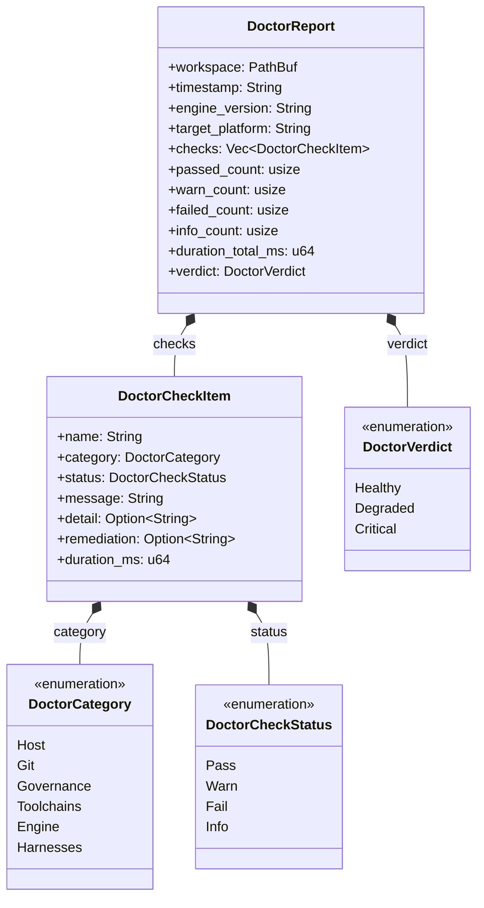

# Feature Architecture: `doctor`

🌐 **[Open Interactive Diagram (Mermaid Live)](https://mermaid.live/view#base64:eyJjb2RlIjoiY2xhc3NEaWFncmFtXG4gICAgZGlyZWN0aW9uIFRCXG5cbiAgICAlJSA9PT09PT09PT09PT09PT09PT09PT09PT09PT09PT09PT09PT09PT09PT09PT09PT09PT09PT09PT09PT09PT09PT09PVxuICAgICUlIPCfp6kgRmVhdHVyZSBTbGljZTogZG9jdG9yICh3aXRoIDEtaG9wIGRvbWFpbiBuZWlnaGJvcnMpXG4gICAgJSUgPT09PT09PT09PT09PT09PT09PT09PT09PT09PT09PT09PT09PT09PT09PT09PT09PT09PT09PT09PT09PT09PT09PT1cblxuICAgIGNsYXNzIERvY3RvckNhdGVnb3J5IHtcbiAgICAgICAgPDxlbnVtZXJhdGlvbj4+XG4gICAgICAgIEhvc3RcbiAgICAgICAgR2l0XG4gICAgICAgIEdvdmVybmFuY2VcbiAgICAgICAgVG9vbGNoYWluc1xuICAgICAgICBFbmdpbmVcbiAgICAgICAgSGFybmVzc2VzXG4gICAgfVxuXG4gICAgY2xhc3MgRG9jdG9yQ2hlY2tJdGVtIHtcbiAgICAgICAgK25hbWU6IFN0cmluZ1xuICAgICAgICArY2F0ZWdvcnk6IERvY3RvckNhdGVnb3J5XG4gICAgICAgICtzdGF0dXM6IERvY3RvckNoZWNrU3RhdHVzXG4gICAgICAgICttZXNzYWdlOiBTdHJpbmdcbiAgICAgICAgK2RldGFpbDogT3B0aW9uflN0cmluZ35cbiAgICAgICAgK3JlbWVkaWF0aW9uOiBPcHRpb25+U3RyaW5nflxuICAgICAgICArZHVyYXRpb25fbXM6IHU2NFxuICAgIH1cblxuICAgIGNsYXNzIERvY3RvckNoZWNrU3RhdHVzIHtcbiAgICAgICAgPDxlbnVtZXJhdGlvbj4+XG4gICAgICAgIFBhc3NcbiAgICAgICAgV2FyblxuICAgICAgICBGYWlsXG4gICAgICAgIEluZm9cbiAgICB9XG5cbiAgICBjbGFzcyBEb2N0b3JSZXBvcnQge1xuICAgICAgICArd29ya3NwYWNlOiBQYXRoQnVmXG4gICAgICAgICt0aW1lc3RhbXA6IFN0cmluZ1xuICAgICAgICArZW5naW5lX3ZlcnNpb246IFN0cmluZ1xuICAgICAgICArdGFyZ2V0X3BsYXRmb3JtOiBTdHJpbmdcbiAgICAgICAgK2NoZWNrczogVmVjfkRvY3RvckNoZWNrSXRlbX5cbiAgICAgICAgK3Bhc3NlZF9jb3VudDogdXNpemVcbiAgICAgICAgK3dhcm5fY291bnQ6IHVzaXplXG4gICAgICAgICtmYWlsZWRfY291bnQ6IHVzaXplXG4gICAgICAgICtpbmZvX2NvdW50OiB1c2l6ZVxuICAgICAgICArZHVyYXRpb25fdG90YWxfbXM6IHU2NFxuICAgICAgICArdmVyZGljdDogRG9jdG9yVmVyZGljdFxuICAgIH1cblxuICAgIGNsYXNzIERvY3RvclZlcmRpY3Qge1xuICAgICAgICA8PGVudW1lcmF0aW9uPj5cbiAgICAgICAgSGVhbHRoeVxuICAgICAgICBEZWdyYWRlZFxuICAgICAgICBDcml0aWNhbFxuICAgIH1cblxuICAgIERvY3RvclJlcG9ydCAqLS0gRG9jdG9yQ2hlY2tJdGVtIDogY2hlY2tzXG4gICAgRG9jdG9yUmVwb3J0ICotLSBEb2N0b3JWZXJkaWN0IDogdmVyZGljdFxuICAgIERvY3RvckNoZWNrSXRlbSAqLS0gRG9jdG9yQ2F0ZWdvcnkgOiBjYXRlZ29yeVxuICAgIERvY3RvckNoZWNrSXRlbSAqLS0gRG9jdG9yQ2hlY2tTdGF0dXMgOiBzdGF0dXMiLCJtZXJtYWlkIjp7InRoZW1lIjoiZGVmYXVsdCJ9LCJhdXRvU3luYyI6dHJ1ZSwidXBkYXRlRWRpdG9yIjpmYWxzZX0=)** • ← [Full Architecture](../../architecture.md) • 📋 [Feature Spec](../../specs/doctor.md)

> Scoped domænemodel for `doctor` (inkl. direkte 1-hop naborelationer). Åbn lokalt med pan/zoom via `xgauntlet topology open --feature doctor`.

