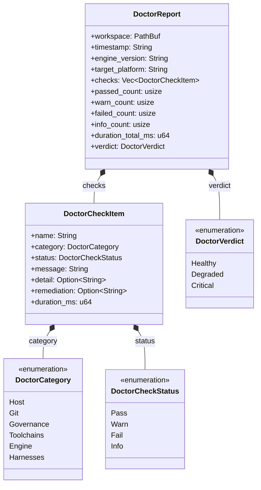

# Feature Architecture: `doctor`

🌐 **[Open Interactive Diagram (Pele Playground)](https://pele.run/playground#source=classDiagram%0A++++direction+TB%0A%0A++++%25%25+%3D%3D%3D%3D%3D%3D%3D%3D%3D%3D%3D%3D%3D%3D%3D%3D%3D%3D%3D%3D%3D%3D%3D%3D%3D%3D%3D%3D%3D%3D%3D%3D%3D%3D%3D%3D%3D%3D%3D%3D%3D%3D%3D%3D%3D%3D%3D%3D%3D%3D%3D%3D%3D%3D%3D%3D%3D%3D%3D%3D%3D%3D%3D%3D%3D%3D%3D%3D%0A++++%25%25+%F0%9F%A7%A9+Feature+Slice%3A+doctor+%28with+1-hop+domain+neighbors%29%0A++++%25%25+%3D%3D%3D%3D%3D%3D%3D%3D%3D%3D%3D%3D%3D%3D%3D%3D%3D%3D%3D%3D%3D%3D%3D%3D%3D%3D%3D%3D%3D%3D%3D%3D%3D%3D%3D%3D%3D%3D%3D%3D%3D%3D%3D%3D%3D%3D%3D%3D%3D%3D%3D%3D%3D%3D%3D%3D%3D%3D%3D%3D%3D%3D%3D%3D%3D%3D%3D%3D%0A%0A++++class+DoctorCategory+%7B%0A++++++++%3C%3Cenumeration%3E%3E%0A++++++++Host%0A++++++++Git%0A++++++++Governance%0A++++++++Toolchains%0A++++++++Engine%0A++++++++Harnesses%0A++++%7D%0A%0A++++class+DoctorCheckItem+%7B%0A++++++++%2Bname%3A+String%0A++++++++%2Bcategory%3A+DoctorCategory%0A++++++++%2Bstatus%3A+DoctorCheckStatus%0A++++++++%2Bmessage%3A+String%0A++++++++%2Bdetail%3A+Option%7EString%7E%0A++++++++%2Bremediation%3A+Option%7EString%7E%0A++++++++%2Bduration_ms%3A+u64%0A++++%7D%0A%0A++++class+DoctorCheckStatus+%7B%0A++++++++%3C%3Cenumeration%3E%3E%0A++++++++Pass%0A++++++++Warn%0A++++++++Fail%0A++++++++Info%0A++++%7D%0A%0A++++class+DoctorReport+%7B%0A++++++++%2Bworkspace%3A+PathBuf%0A++++++++%2Btimestamp%3A+String%0A++++++++%2Bengine_version%3A+String%0A++++++++%2Btarget_platform%3A+String%0A++++++++%2Bchecks%3A+Vec%7EDoctorCheckItem%7E%0A++++++++%2Bpassed_count%3A+usize%0A++++++++%2Bwarn_count%3A+usize%0A++++++++%2Bfailed_count%3A+usize%0A++++++++%2Binfo_count%3A+usize%0A++++++++%2Bduration_total_ms%3A+u64%0A++++++++%2Bverdict%3A+DoctorVerdict%0A++++%7D%0A%0A++++class+DoctorVerdict+%7B%0A++++++++%3C%3Cenumeration%3E%3E%0A++++++++Healthy%0A++++++++Degraded%0A++++++++Critical%0A++++%7D%0A%0A++++DoctorReport+*--+DoctorCheckItem+%3A+checks%0A++++DoctorReport+*--+DoctorVerdict+%3A+verdict%0A++++DoctorCheckItem+*--+DoctorCategory+%3A+category%0A++++DoctorCheckItem+*--+DoctorCheckStatus+%3A+status)** • ← [Full Architecture](../../architecture.md) • 📋 [Feature Spec](../../specs/doctor.md)

> Scoped domænemodel for `doctor` (inkl. direkte 1-hop naborelationer). Åbn lokalt med pan/zoom via `xgauntlet topology open --feature doctor`.

