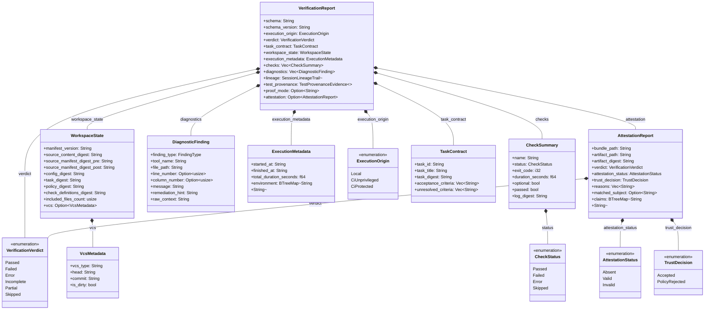

# Feature Architecture: `evidence`

🌐 **[Open Interactive Diagram (Pele Playground)](https://pele.run/playground#source=classDiagram%0A++++direction+TB%0A%0A++++%25%25+%3D%3D%3D%3D%3D%3D%3D%3D%3D%3D%3D%3D%3D%3D%3D%3D%3D%3D%3D%3D%3D%3D%3D%3D%3D%3D%3D%3D%3D%3D%3D%3D%3D%3D%3D%3D%3D%3D%3D%3D%3D%3D%3D%3D%3D%3D%3D%3D%3D%3D%3D%3D%3D%3D%3D%3D%3D%3D%3D%3D%3D%3D%3D%3D%3D%3D%3D%3D%0A++++%25%25+%F0%9F%A7%A9+Feature+Slice%3A+evidence+%28with+1-hop+domain+neighbors%29%0A++++%25%25+%3D%3D%3D%3D%3D%3D%3D%3D%3D%3D%3D%3D%3D%3D%3D%3D%3D%3D%3D%3D%3D%3D%3D%3D%3D%3D%3D%3D%3D%3D%3D%3D%3D%3D%3D%3D%3D%3D%3D%3D%3D%3D%3D%3D%3D%3D%3D%3D%3D%3D%3D%3D%3D%3D%3D%3D%3D%3D%3D%3D%3D%3D%3D%3D%3D%3D%3D%3D%0A%0A++++class+AttestationReport+%7B%0A++++++++%2Bbundle_path%3A+String%0A++++++++%2Bartifact_path%3A+String%0A++++++++%2Bartifact_digest%3A+String%0A++++++++%2Bverdict%3A+VerificationVerdict%0A++++++++%2Battestation_status%3A+AttestationStatus%0A++++++++%2Btrust_decision%3A+TrustDecision%0A++++++++%2Breasons%3A+Vec%7EString%7E%0A++++++++%2Bmatched_subject%3A+Option%7EString%7E%0A++++++++%2Bclaims%3A+BTreeMap%7EString%0A++++++++%2BString%7E%0A++++%7D%0A%0A++++class+AttestationStatus+%7B%0A++++++++%3C%3Cenumeration%3E%3E%0A++++++++Absent%0A++++++++Valid%0A++++++++Invalid%0A++++%7D%0A%0A++++class+CheckStatus+%7B%0A++++++++%3C%3Cenumeration%3E%3E%0A++++++++Passed%0A++++++++Failed%0A++++++++Error%0A++++++++Skipped%0A++++%7D%0A%0A++++class+CheckSummary+%7B%0A++++++++%2Bname%3A+String%0A++++++++%2Bstatus%3A+CheckStatus%0A++++++++%2Bexit_code%3A+i32%0A++++++++%2Bduration_seconds%3A+f64%0A++++++++%2Boptional%3A+bool%0A++++++++%2Bpassed%3A+bool%0A++++++++%2Blog_digest%3A+String%0A++++%7D%0A%0A++++class+DiagnosticFinding+%7B%0A++++++++%2Bfinding_type%3A+FindingType%0A++++++++%2Btool_name%3A+String%0A++++++++%2Bfile_path%3A+String%0A++++++++%2Bline_number%3A+Option%7Eusize%7E%0A++++++++%2Bcolumn_number%3A+Option%7Eusize%7E%0A++++++++%2Bmessage%3A+String%0A++++++++%2Bremediation_hint%3A+String%0A++++++++%2Braw_context%3A+String%0A++++%7D%0A%0A++++class+ExecutionMetadata+%7B%0A++++++++%2Bstarted_at%3A+String%0A++++++++%2Bfinished_at%3A+String%0A++++++++%2Btotal_duration_seconds%3A+f64%0A++++++++%2Benvironment%3A+BTreeMap%7EString%0A++++++++%2BString%7E%0A++++%7D%0A%0A++++class+ExecutionOrigin+%7B%0A++++++++%3C%3Cenumeration%3E%3E%0A++++++++Local%0A++++++++CiUnprivileged%0A++++++++CiProtected%0A++++%7D%0A%0A++++class+TaskContract+%7B%0A++++++++%2Btask_id%3A+String%0A++++++++%2Btask_title%3A+String%0A++++++++%2Btask_digest%3A+String%0A++++++++%2Bacceptance_criteria%3A+Vec%7EString%7E%0A++++++++%2Bunresolved_criteria%3A+Vec%7EString%7E%0A++++%7D%0A%0A++++class+TrustDecision+%7B%0A++++++++%3C%3Cenumeration%3E%3E%0A++++++++Accepted%0A++++++++PolicyRejected%0A++++%7D%0A%0A++++class+VcsMetadata+%7B%0A++++++++%2Bvcs_type%3A+String%0A++++++++%2Bhead%3A+String%0A++++++++%2Bcommit%3A+String%0A++++++++%2Bis_dirty%3A+bool%0A++++%7D%0A%0A++++class+VerificationReport+%7B%0A++++++++%2Bschema%3A+String%0A++++++++%2Bschema_version%3A+String%0A++++++++%2Bexecution_origin%3A+ExecutionOrigin%0A++++++++%2Bverdict%3A+VerificationVerdict%0A++++++++%2Btask_contract%3A+TaskContract%0A++++++++%2Bworkspace_state%3A+WorkspaceState%0A++++++++%2Bexecution_metadata%3A+ExecutionMetadata%0A++++++++%2Bchecks%3A+Vec%7ECheckSummary%7E%0A++++++++%2Bdiagnostics%3A+Vec%7EDiagnosticFinding%7E%0A++++++++%2Blineage%3A+SessionLineageTrail%7E%0A++++++++%2Btest_provenance%3A+TestProvenanceEvidence%7E%7E%0A++++++++%2Bproof_mode%3A+Option%7EString%7E%0A++++++++%2Battestation%3A+Option%7EAttestationReport%7E%0A++++%7D%0A%0A++++class+VerificationVerdict+%7B%0A++++++++%3C%3Cenumeration%3E%3E%0A++++++++Passed%0A++++++++Failed%0A++++++++Error%0A++++++++Incomplete%0A++++++++Partial%0A++++++++Skipped%0A++++%7D%0A%0A++++class+WorkspaceState+%7B%0A++++++++%2Bmanifest_version%3A+String%0A++++++++%2Bsource_content_digest%3A+String%0A++++++++%2Bsource_manifest_digest_pre%3A+String%0A++++++++%2Bsource_manifest_digest_post%3A+String%0A++++++++%2Bconfig_digest%3A+String%0A++++++++%2Btask_digest%3A+String%0A++++++++%2Bpolicy_digest%3A+String%0A++++++++%2Bcheck_definitions_digest%3A+String%0A++++++++%2Bincluded_files_count%3A+usize%0A++++++++%2Bvcs%3A+Option%7EVcsMetadata%7E%0A++++%7D%0A%0A++++VerificationReport+*--+ExecutionOrigin+%3A+execution_origin%0A++++VerificationReport+*--+VerificationVerdict+%3A+verdict%0A++++VerificationReport+*--+TaskContract+%3A+task_contract%0A++++VerificationReport+*--+WorkspaceState+%3A+workspace_state%0A++++VerificationReport+*--+ExecutionMetadata+%3A+execution_metadata%0A++++VerificationReport+*--+CheckSummary+%3A+checks%0A++++VerificationReport+*--+DiagnosticFinding+%3A+diagnostics%0A++++VerificationReport+*--+AttestationReport+%3A+attestation%0A++++CheckSummary+*--+CheckStatus+%3A+status%0A++++WorkspaceState+*--+VcsMetadata+%3A+vcs%0A++++AttestationReport+*--+VerificationVerdict+%3A+verdict%0A++++AttestationReport+*--+AttestationStatus+%3A+attestation_status%0A++++AttestationReport+*--+TrustDecision+%3A+trust_decision)** • ← [Full Architecture](../../architecture.md) • 📋 [Feature Spec](../../specs/evidence.md)

> Scoped domænemodel for `evidence` (inkl. direkte 1-hop naborelationer). Åbn lokalt med pan/zoom via `xgauntlet topology open --feature evidence`.

