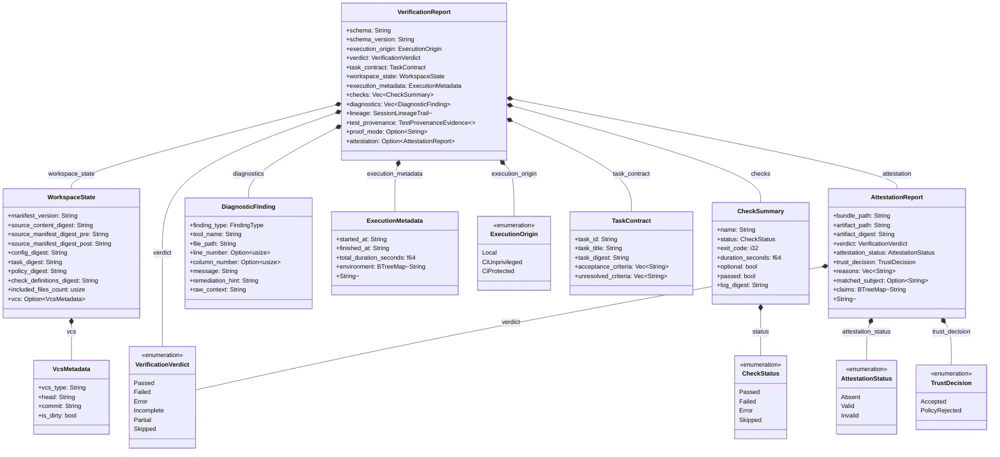

# Feature Architecture: `evidence`

🌐 **[Open Interactive Diagram (Mermaid Live)](https://mermaid.live/view#base64:eyJjb2RlIjoiY2xhc3NEaWFncmFtXG4gICAgZGlyZWN0aW9uIFRCXG5cbiAgICAlJSA9PT09PT09PT09PT09PT09PT09PT09PT09PT09PT09PT09PT09PT09PT09PT09PT09PT09PT09PT09PT09PT09PT09PVxuICAgICUlIPCfp6kgRmVhdHVyZSBTbGljZTogZXZpZGVuY2UgKHdpdGggMS1ob3AgZG9tYWluIG5laWdoYm9ycylcbiAgICAlJSA9PT09PT09PT09PT09PT09PT09PT09PT09PT09PT09PT09PT09PT09PT09PT09PT09PT09PT09PT09PT09PT09PT09PVxuXG4gICAgY2xhc3MgQXR0ZXN0YXRpb25SZXBvcnQge1xuICAgICAgICArYnVuZGxlX3BhdGg6IFN0cmluZ1xuICAgICAgICArYXJ0aWZhY3RfcGF0aDogU3RyaW5nXG4gICAgICAgICthcnRpZmFjdF9kaWdlc3Q6IFN0cmluZ1xuICAgICAgICArdmVyZGljdDogVmVyaWZpY2F0aW9uVmVyZGljdFxuICAgICAgICArYXR0ZXN0YXRpb25fc3RhdHVzOiBBdHRlc3RhdGlvblN0YXR1c1xuICAgICAgICArdHJ1c3RfZGVjaXNpb246IFRydXN0RGVjaXNpb25cbiAgICAgICAgK3JlYXNvbnM6IFZlY35TdHJpbmd+XG4gICAgICAgICttYXRjaGVkX3N1YmplY3Q6IE9wdGlvbn5TdHJpbmd+XG4gICAgICAgICtjbGFpbXM6IEJUcmVlTWFwflN0cmluZ1xuICAgICAgICArU3RyaW5nflxuICAgIH1cblxuICAgIGNsYXNzIEF0dGVzdGF0aW9uU3RhdHVzIHtcbiAgICAgICAgPDxlbnVtZXJhdGlvbj4+XG4gICAgICAgIEFic2VudFxuICAgICAgICBWYWxpZFxuICAgICAgICBJbnZhbGlkXG4gICAgfVxuXG4gICAgY2xhc3MgQ2hlY2tTdGF0dXMge1xuICAgICAgICA8PGVudW1lcmF0aW9uPj5cbiAgICAgICAgUGFzc2VkXG4gICAgICAgIEZhaWxlZFxuICAgICAgICBFcnJvclxuICAgICAgICBTa2lwcGVkXG4gICAgfVxuXG4gICAgY2xhc3MgQ2hlY2tTdW1tYXJ5IHtcbiAgICAgICAgK25hbWU6IFN0cmluZ1xuICAgICAgICArc3RhdHVzOiBDaGVja1N0YXR1c1xuICAgICAgICArZXhpdF9jb2RlOiBpMzJcbiAgICAgICAgK2R1cmF0aW9uX3NlY29uZHM6IGY2NFxuICAgICAgICArb3B0aW9uYWw6IGJvb2xcbiAgICAgICAgK3Bhc3NlZDogYm9vbFxuICAgICAgICArbG9nX2RpZ2VzdDogU3RyaW5nXG4gICAgfVxuXG4gICAgY2xhc3MgRGlhZ25vc3RpY0ZpbmRpbmcge1xuICAgICAgICArZmluZGluZ190eXBlOiBGaW5kaW5nVHlwZVxuICAgICAgICArdG9vbF9uYW1lOiBTdHJpbmdcbiAgICAgICAgK2ZpbGVfcGF0aDogU3RyaW5nXG4gICAgICAgICtsaW5lX251bWJlcjogT3B0aW9ufnVzaXplflxuICAgICAgICArY29sdW1uX251bWJlcjogT3B0aW9ufnVzaXplflxuICAgICAgICArbWVzc2FnZTogU3RyaW5nXG4gICAgICAgICtyZW1lZGlhdGlvbl9oaW50OiBTdHJpbmdcbiAgICAgICAgK3Jhd19jb250ZXh0OiBTdHJpbmdcbiAgICB9XG5cbiAgICBjbGFzcyBFeGVjdXRpb25NZXRhZGF0YSB7XG4gICAgICAgICtzdGFydGVkX2F0OiBTdHJpbmdcbiAgICAgICAgK2ZpbmlzaGVkX2F0OiBTdHJpbmdcbiAgICAgICAgK3RvdGFsX2R1cmF0aW9uX3NlY29uZHM6IGY2NFxuICAgICAgICArZW52aXJvbm1lbnQ6IEJUcmVlTWFwflN0cmluZ1xuICAgICAgICArU3RyaW5nflxuICAgIH1cblxuICAgIGNsYXNzIEV4ZWN1dGlvbk9yaWdpbiB7XG4gICAgICAgIDw8ZW51bWVyYXRpb24+PlxuICAgICAgICBMb2NhbFxuICAgICAgICBDaVVucHJpdmlsZWdlZFxuICAgICAgICBDaVByb3RlY3RlZFxuICAgIH1cblxuICAgIGNsYXNzIFRhc2tDb250cmFjdCB7XG4gICAgICAgICt0YXNrX2lkOiBTdHJpbmdcbiAgICAgICAgK3Rhc2tfdGl0bGU6IFN0cmluZ1xuICAgICAgICArdGFza19kaWdlc3Q6IFN0cmluZ1xuICAgICAgICArYWNjZXB0YW5jZV9jcml0ZXJpYTogVmVjflN0cmluZ35cbiAgICAgICAgK3VucmVzb2x2ZWRfY3JpdGVyaWE6IFZlY35TdHJpbmd+XG4gICAgfVxuXG4gICAgY2xhc3MgVHJ1c3REZWNpc2lvbiB7XG4gICAgICAgIDw8ZW51bWVyYXRpb24+PlxuICAgICAgICBBY2NlcHRlZFxuICAgICAgICBQb2xpY3lSZWplY3RlZFxuICAgIH1cblxuICAgIGNsYXNzIFZjc01ldGFkYXRhIHtcbiAgICAgICAgK3Zjc190eXBlOiBTdHJpbmdcbiAgICAgICAgK2hlYWQ6IFN0cmluZ1xuICAgICAgICArY29tbWl0OiBTdHJpbmdcbiAgICAgICAgK2lzX2RpcnR5OiBib29sXG4gICAgfVxuXG4gICAgY2xhc3MgVmVyaWZpY2F0aW9uUmVwb3J0IHtcbiAgICAgICAgK3NjaGVtYTogU3RyaW5nXG4gICAgICAgICtzY2hlbWFfdmVyc2lvbjogU3RyaW5nXG4gICAgICAgICtleGVjdXRpb25fb3JpZ2luOiBFeGVjdXRpb25PcmlnaW5cbiAgICAgICAgK3ZlcmRpY3Q6IFZlcmlmaWNhdGlvblZlcmRpY3RcbiAgICAgICAgK3Rhc2tfY29udHJhY3Q6IFRhc2tDb250cmFjdFxuICAgICAgICArd29ya3NwYWNlX3N0YXRlOiBXb3Jrc3BhY2VTdGF0ZVxuICAgICAgICArZXhlY3V0aW9uX21ldGFkYXRhOiBFeGVjdXRpb25NZXRhZGF0YVxuICAgICAgICArY2hlY2tzOiBWZWN+Q2hlY2tTdW1tYXJ5flxuICAgICAgICArZGlhZ25vc3RpY3M6IFZlY35EaWFnbm9zdGljRmluZGluZ35cbiAgICAgICAgK2xpbmVhZ2U6IFNlc3Npb25MaW5lYWdlVHJhaWx+XG4gICAgICAgICt0ZXN0X3Byb3ZlbmFuY2U6IFRlc3RQcm92ZW5hbmNlRXZpZGVuY2V+flxuICAgICAgICArcHJvb2ZfbW9kZTogT3B0aW9uflN0cmluZ35cbiAgICAgICAgK2F0dGVzdGF0aW9uOiBPcHRpb25+QXR0ZXN0YXRpb25SZXBvcnR+XG4gICAgfVxuXG4gICAgY2xhc3MgVmVyaWZpY2F0aW9uVmVyZGljdCB7XG4gICAgICAgIDw8ZW51bWVyYXRpb24+PlxuICAgICAgICBQYXNzZWRcbiAgICAgICAgRmFpbGVkXG4gICAgICAgIEVycm9yXG4gICAgICAgIEluY29tcGxldGVcbiAgICAgICAgUGFydGlhbFxuICAgICAgICBTa2lwcGVkXG4gICAgfVxuXG4gICAgY2xhc3MgV29ya3NwYWNlU3RhdGUge1xuICAgICAgICArbWFuaWZlc3RfdmVyc2lvbjogU3RyaW5nXG4gICAgICAgICtzb3VyY2VfY29udGVudF9kaWdlc3Q6IFN0cmluZ1xuICAgICAgICArc291cmNlX21hbmlmZXN0X2RpZ2VzdF9wcmU6IFN0cmluZ1xuICAgICAgICArc291cmNlX21hbmlmZXN0X2RpZ2VzdF9wb3N0OiBTdHJpbmdcbiAgICAgICAgK2NvbmZpZ19kaWdlc3Q6IFN0cmluZ1xuICAgICAgICArdGFza19kaWdlc3Q6IFN0cmluZ1xuICAgICAgICArcG9saWN5X2RpZ2VzdDogU3RyaW5nXG4gICAgICAgICtjaGVja19kZWZpbml0aW9uc19kaWdlc3Q6IFN0cmluZ1xuICAgICAgICAraW5jbHVkZWRfZmlsZXNfY291bnQ6IHVzaXplXG4gICAgICAgICt2Y3M6IE9wdGlvbn5WY3NNZXRhZGF0YX5cbiAgICB9XG5cbiAgICBBdHRlc3RhdGlvblJlcG9ydCAqLS0gVmVyaWZpY2F0aW9uVmVyZGljdCA6IHZlcmRpY3RcbiAgICBBdHRlc3RhdGlvblJlcG9ydCAqLS0gQXR0ZXN0YXRpb25TdGF0dXMgOiBhdHRlc3RhdGlvbl9zdGF0dXNcbiAgICBBdHRlc3RhdGlvblJlcG9ydCAqLS0gVHJ1c3REZWNpc2lvbiA6IHRydXN0X2RlY2lzaW9uXG4gICAgVmVyaWZpY2F0aW9uUmVwb3J0ICotLSBFeGVjdXRpb25PcmlnaW4gOiBleGVjdXRpb25fb3JpZ2luXG4gICAgVmVyaWZpY2F0aW9uUmVwb3J0ICotLSBWZXJpZmljYXRpb25WZXJkaWN0IDogdmVyZGljdFxuICAgIFZlcmlmaWNhdGlvblJlcG9ydCAqLS0gVGFza0NvbnRyYWN0IDogdGFza19jb250cmFjdFxuICAgIFZlcmlmaWNhdGlvblJlcG9ydCAqLS0gV29ya3NwYWNlU3RhdGUgOiB3b3Jrc3BhY2Vfc3RhdGVcbiAgICBWZXJpZmljYXRpb25SZXBvcnQgKi0tIEV4ZWN1dGlvbk1ldGFkYXRhIDogZXhlY3V0aW9uX21ldGFkYXRhXG4gICAgVmVyaWZpY2F0aW9uUmVwb3J0ICotLSBDaGVja1N1bW1hcnkgOiBjaGVja3NcbiAgICBWZXJpZmljYXRpb25SZXBvcnQgKi0tIERpYWdub3N0aWNGaW5kaW5nIDogZGlhZ25vc3RpY3NcbiAgICBWZXJpZmljYXRpb25SZXBvcnQgKi0tIEF0dGVzdGF0aW9uUmVwb3J0IDogYXR0ZXN0YXRpb25cbiAgICBXb3Jrc3BhY2VTdGF0ZSAqLS0gVmNzTWV0YWRhdGEgOiB2Y3NcbiAgICBDaGVja1N1bW1hcnkgKi0tIENoZWNrU3RhdHVzIDogc3RhdHVzIiwibWVybWFpZCI6eyJ0aGVtZSI6ImRlZmF1bHQifSwiYXV0b1N5bmMiOnRydWUsInVwZGF0ZUVkaXRvciI6ZmFsc2V9)** • ← [Full Architecture](../../architecture.md) • 📋 [Feature Spec](../../specs/evidence.md)

> Scoped domænemodel for `evidence` (inkl. direkte 1-hop naborelationer). Åbn lokalt med pan/zoom via `xgauntlet topology open --feature evidence`.

