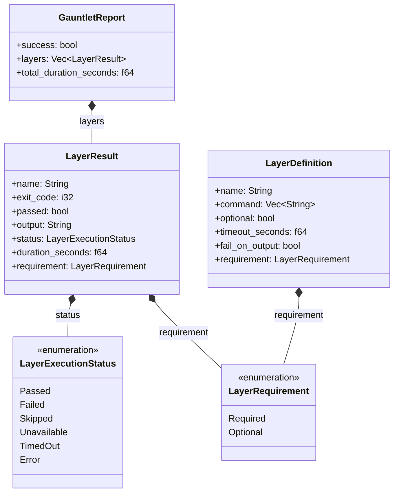

# Feature Architecture: `gauntlet`

🌐 **[Open Interactive Diagram (Mermaid Live)](https://mermaid.live/view#base64:eyJjb2RlIjoiY2xhc3NEaWFncmFtXG4gICAgZGlyZWN0aW9uIFRCXG5cbiAgICAlJSA9PT09PT09PT09PT09PT09PT09PT09PT09PT09PT09PT09PT09PT09PT09PT09PT09PT09PT09PT09PT09PT09PT09PVxuICAgICUlIPCfp6kgRmVhdHVyZSBTbGljZTogZ2F1bnRsZXQgKHdpdGggMS1ob3AgZG9tYWluIG5laWdoYm9ycylcbiAgICAlJSA9PT09PT09PT09PT09PT09PT09PT09PT09PT09PT09PT09PT09PT09PT09PT09PT09PT09PT09PT09PT09PT09PT09PVxuXG4gICAgY2xhc3MgR2F1bnRsZXRSZXBvcnQge1xuICAgICAgICArc3VjY2VzczogYm9vbFxuICAgICAgICArbGF5ZXJzOiBWZWN+TGF5ZXJSZXN1bHR+XG4gICAgICAgICt0b3RhbF9kdXJhdGlvbl9zZWNvbmRzOiBmNjRcbiAgICB9XG5cbiAgICBjbGFzcyBMYXllckRlZmluaXRpb24ge1xuICAgICAgICArbmFtZTogU3RyaW5nXG4gICAgICAgICtjb21tYW5kOiBWZWN+U3RyaW5nflxuICAgICAgICArb3B0aW9uYWw6IGJvb2xcbiAgICAgICAgK3RpbWVvdXRfc2Vjb25kczogZjY0XG4gICAgICAgICtmYWlsX29uX291dHB1dDogYm9vbFxuICAgICAgICArcmVxdWlyZW1lbnQ6IExheWVyUmVxdWlyZW1lbnRcbiAgICB9XG5cbiAgICBjbGFzcyBMYXllckV4ZWN1dGlvblN0YXR1cyB7XG4gICAgICAgIDw8ZW51bWVyYXRpb24+PlxuICAgICAgICBQYXNzZWRcbiAgICAgICAgRmFpbGVkXG4gICAgICAgIFNraXBwZWRcbiAgICAgICAgVW5hdmFpbGFibGVcbiAgICAgICAgVGltZWRPdXRcbiAgICAgICAgRXJyb3JcbiAgICB9XG5cbiAgICBjbGFzcyBMYXllclJlcXVpcmVtZW50IHtcbiAgICAgICAgPDxlbnVtZXJhdGlvbj4+XG4gICAgICAgIFJlcXVpcmVkXG4gICAgICAgIE9wdGlvbmFsXG4gICAgfVxuXG4gICAgY2xhc3MgTGF5ZXJSZXN1bHQge1xuICAgICAgICArbmFtZTogU3RyaW5nXG4gICAgICAgICtleGl0X2NvZGU6IGkzMlxuICAgICAgICArcGFzc2VkOiBib29sXG4gICAgICAgICtvdXRwdXQ6IFN0cmluZ1xuICAgICAgICArc3RhdHVzOiBMYXllckV4ZWN1dGlvblN0YXR1c1xuICAgICAgICArZHVyYXRpb25fc2Vjb25kczogZjY0XG4gICAgICAgICtyZXF1aXJlbWVudDogTGF5ZXJSZXF1aXJlbWVudFxuICAgIH1cblxuICAgIEdhdW50bGV0UmVwb3J0ICotLSBMYXllclJlc3VsdCA6IGxheWVyc1xuICAgIExheWVyUmVzdWx0ICotLSBMYXllckV4ZWN1dGlvblN0YXR1cyA6IHN0YXR1c1xuICAgIExheWVyUmVzdWx0ICotLSBMYXllclJlcXVpcmVtZW50IDogcmVxdWlyZW1lbnRcbiAgICBMYXllckRlZmluaXRpb24gKi0tIExheWVyUmVxdWlyZW1lbnQgOiByZXF1aXJlbWVudCIsIm1lcm1haWQiOnsidGhlbWUiOiJkZWZhdWx0In0sImF1dG9TeW5jIjp0cnVlLCJ1cGRhdGVFZGl0b3IiOmZhbHNlfQ==)** • ← [Full Architecture](../../architecture.md) • 📋 [Feature Spec](../../specs/gauntlet.md)

> Scoped domænemodel for `gauntlet` (inkl. direkte 1-hop naborelationer). Åbn lokalt med pan/zoom via `xgauntlet topology open --feature gauntlet`.

