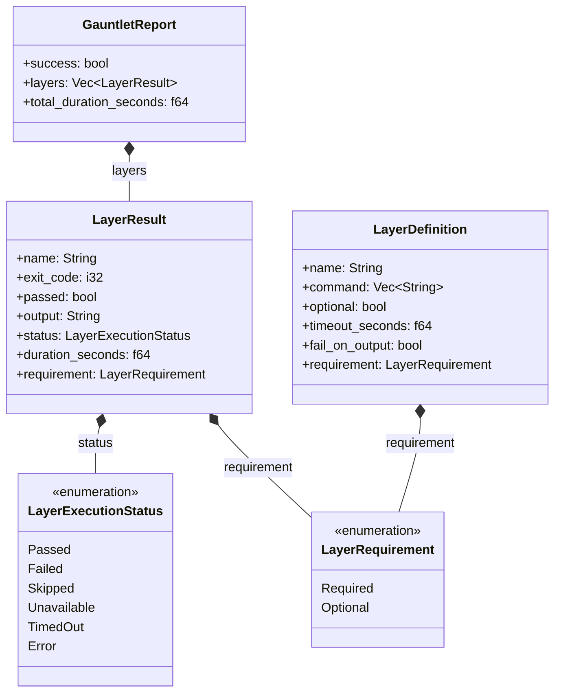

# Feature Architecture: `gauntlet`

🌐 **[Open Interactive Diagram (Pele Playground)](https://pele.run/playground#source=classDiagram%0A++++direction+TB%0A%0A++++%25%25+%3D%3D%3D%3D%3D%3D%3D%3D%3D%3D%3D%3D%3D%3D%3D%3D%3D%3D%3D%3D%3D%3D%3D%3D%3D%3D%3D%3D%3D%3D%3D%3D%3D%3D%3D%3D%3D%3D%3D%3D%3D%3D%3D%3D%3D%3D%3D%3D%3D%3D%3D%3D%3D%3D%3D%3D%3D%3D%3D%3D%3D%3D%3D%3D%3D%3D%3D%3D%0A++++%25%25+%F0%9F%A7%A9+Feature+Slice%3A+gauntlet+%28with+1-hop+domain+neighbors%29%0A++++%25%25+%3D%3D%3D%3D%3D%3D%3D%3D%3D%3D%3D%3D%3D%3D%3D%3D%3D%3D%3D%3D%3D%3D%3D%3D%3D%3D%3D%3D%3D%3D%3D%3D%3D%3D%3D%3D%3D%3D%3D%3D%3D%3D%3D%3D%3D%3D%3D%3D%3D%3D%3D%3D%3D%3D%3D%3D%3D%3D%3D%3D%3D%3D%3D%3D%3D%3D%3D%3D%0A%0A++++class+GauntletReport+%7B%0A++++++++%2Bsuccess%3A+bool%0A++++++++%2Blayers%3A+Vec%7ELayerResult%7E%0A++++++++%2Btotal_duration_seconds%3A+f64%0A++++%7D%0A%0A++++class+LayerDefinition+%7B%0A++++++++%2Bname%3A+String%0A++++++++%2Bcommand%3A+Vec%7EString%7E%0A++++++++%2Boptional%3A+bool%0A++++++++%2Btimeout_seconds%3A+f64%0A++++++++%2Bfail_on_output%3A+bool%0A++++++++%2Brequirement%3A+LayerRequirement%0A++++%7D%0A%0A++++class+LayerExecutionStatus+%7B%0A++++++++%3C%3Cenumeration%3E%3E%0A++++++++Passed%0A++++++++Failed%0A++++++++Skipped%0A++++++++Unavailable%0A++++++++TimedOut%0A++++++++Error%0A++++%7D%0A%0A++++class+LayerRequirement+%7B%0A++++++++%3C%3Cenumeration%3E%3E%0A++++++++Required%0A++++++++Optional%0A++++%7D%0A%0A++++class+LayerResult+%7B%0A++++++++%2Bname%3A+String%0A++++++++%2Bexit_code%3A+i32%0A++++++++%2Bpassed%3A+bool%0A++++++++%2Boutput%3A+String%0A++++++++%2Bstatus%3A+LayerExecutionStatus%0A++++++++%2Bduration_seconds%3A+f64%0A++++++++%2Brequirement%3A+LayerRequirement%0A++++%7D%0A%0A++++LayerResult+*--+LayerExecutionStatus+%3A+status%0A++++LayerResult+*--+LayerRequirement+%3A+requirement%0A++++LayerDefinition+*--+LayerRequirement+%3A+requirement%0A++++GauntletReport+*--+LayerResult+%3A+layers)** • ← [Full Architecture](../../architecture.md) • 📋 [Feature Spec](../../specs/gauntlet.md)

> Scoped domænemodel for `gauntlet` (inkl. direkte 1-hop naborelationer). Åbn lokalt med pan/zoom via `xgauntlet topology open --feature gauntlet`.

