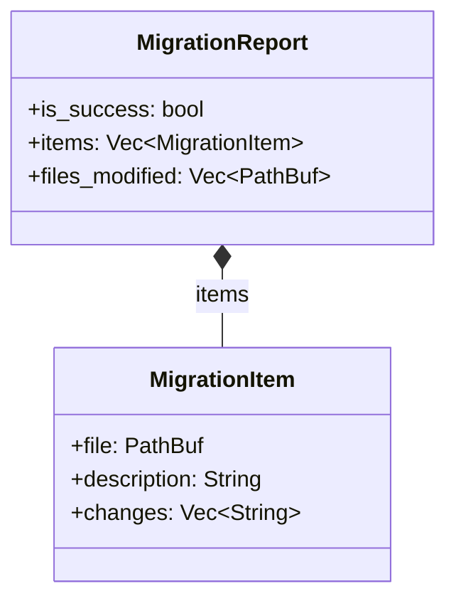

# Feature Architecture: `migration`

🌐 **[Open Interactive Diagram (Pele Playground)](https://pele.run/playground#source=classDiagram%0A++++direction+TB%0A%0A++++%25%25+%3D%3D%3D%3D%3D%3D%3D%3D%3D%3D%3D%3D%3D%3D%3D%3D%3D%3D%3D%3D%3D%3D%3D%3D%3D%3D%3D%3D%3D%3D%3D%3D%3D%3D%3D%3D%3D%3D%3D%3D%3D%3D%3D%3D%3D%3D%3D%3D%3D%3D%3D%3D%3D%3D%3D%3D%3D%3D%3D%3D%3D%3D%3D%3D%3D%3D%3D%3D%0A++++%25%25+%F0%9F%A7%A9+Feature+Slice%3A+migration+%28with+1-hop+domain+neighbors%29%0A++++%25%25+%3D%3D%3D%3D%3D%3D%3D%3D%3D%3D%3D%3D%3D%3D%3D%3D%3D%3D%3D%3D%3D%3D%3D%3D%3D%3D%3D%3D%3D%3D%3D%3D%3D%3D%3D%3D%3D%3D%3D%3D%3D%3D%3D%3D%3D%3D%3D%3D%3D%3D%3D%3D%3D%3D%3D%3D%3D%3D%3D%3D%3D%3D%3D%3D%3D%3D%3D%3D%0A%0A++++class+MigrationItem+%7B%0A++++++++%2Bfile%3A+PathBuf%0A++++++++%2Bdescription%3A+String%0A++++++++%2Bchanges%3A+Vec%7EString%7E%0A++++%7D%0A%0A++++class+MigrationReport+%7B%0A++++++++%2Bis_success%3A+bool%0A++++++++%2Bitems%3A+Vec%7EMigrationItem%7E%0A++++++++%2Bfiles_modified%3A+Vec%7EPathBuf%7E%0A++++%7D%0A%0A++++MigrationReport+*--+MigrationItem+%3A+items)** • ← [Full Architecture](../../architecture.md) • 📋 [Feature Spec](../../specs/migration.md)

> Scoped domænemodel for `migration` (inkl. direkte 1-hop naborelationer). Åbn lokalt med pan/zoom via `xgauntlet topology open --feature migration`.

