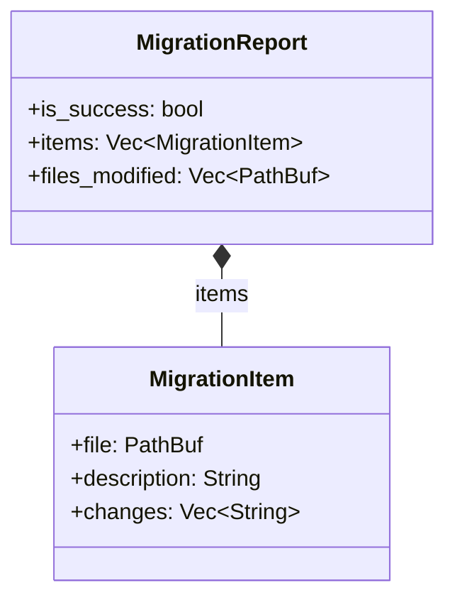

# Feature Architecture: `migration`

🌐 **[Open Interactive Diagram (Mermaid Live)](https://mermaid.live/view#base64:eyJjb2RlIjoiY2xhc3NEaWFncmFtXG4gICAgZGlyZWN0aW9uIFRCXG5cbiAgICAlJSA9PT09PT09PT09PT09PT09PT09PT09PT09PT09PT09PT09PT09PT09PT09PT09PT09PT09PT09PT09PT09PT09PT09PVxuICAgICUlIPCfp6kgRmVhdHVyZSBTbGljZTogbWlncmF0aW9uICh3aXRoIDEtaG9wIGRvbWFpbiBuZWlnaGJvcnMpXG4gICAgJSUgPT09PT09PT09PT09PT09PT09PT09PT09PT09PT09PT09PT09PT09PT09PT09PT09PT09PT09PT09PT09PT09PT09PT1cblxuICAgIGNsYXNzIE1pZ3JhdGlvbkl0ZW0ge1xuICAgICAgICArZmlsZTogUGF0aEJ1ZlxuICAgICAgICArZGVzY3JpcHRpb246IFN0cmluZ1xuICAgICAgICArY2hhbmdlczogVmVjflN0cmluZ35cbiAgICB9XG5cbiAgICBjbGFzcyBNaWdyYXRpb25SZXBvcnQge1xuICAgICAgICAraXNfc3VjY2VzczogYm9vbFxuICAgICAgICAraXRlbXM6IFZlY35NaWdyYXRpb25JdGVtflxuICAgICAgICArZmlsZXNfbW9kaWZpZWQ6IFZlY35QYXRoQnVmflxuICAgIH1cblxuICAgIE1pZ3JhdGlvblJlcG9ydCAqLS0gTWlncmF0aW9uSXRlbSA6IGl0ZW1zIiwibWVybWFpZCI6eyJ0aGVtZSI6ImRlZmF1bHQifSwiYXV0b1N5bmMiOnRydWUsInVwZGF0ZUVkaXRvciI6ZmFsc2V9)** • ← [Full Architecture](../../architecture.md) • 📋 [Feature Spec](../../specs/migration.md)

> Scoped domænemodel for `migration` (inkl. direkte 1-hop naborelationer). Åbn lokalt med pan/zoom via `xgauntlet topology open --feature migration`.

