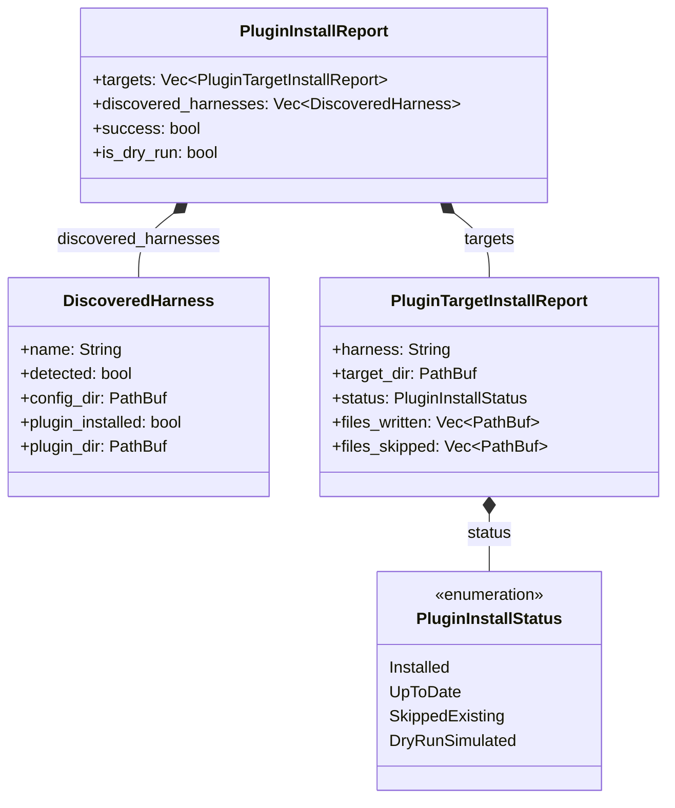

# Feature Architecture: `plugin`

🌐 **[Open Interactive Diagram (Mermaid Live)](https://mermaid.live/view#base64:eyJjb2RlIjoiY2xhc3NEaWFncmFtXG4gICAgZGlyZWN0aW9uIFRCXG5cbiAgICAlJSA9PT09PT09PT09PT09PT09PT09PT09PT09PT09PT09PT09PT09PT09PT09PT09PT09PT09PT09PT09PT09PT09PT09PVxuICAgICUlIPCfp6kgRmVhdHVyZSBTbGljZTogcGx1Z2luICh3aXRoIDEtaG9wIGRvbWFpbiBuZWlnaGJvcnMpXG4gICAgJSUgPT09PT09PT09PT09PT09PT09PT09PT09PT09PT09PT09PT09PT09PT09PT09PT09PT09PT09PT09PT09PT09PT09PT1cblxuICAgIGNsYXNzIERpc2NvdmVyZWRIYXJuZXNzIHtcbiAgICAgICAgK25hbWU6IFN0cmluZ1xuICAgICAgICArZGV0ZWN0ZWQ6IGJvb2xcbiAgICAgICAgK2NvbmZpZ19kaXI6IFBhdGhCdWZcbiAgICAgICAgK3BsdWdpbl9pbnN0YWxsZWQ6IGJvb2xcbiAgICAgICAgK3BsdWdpbl9kaXI6IFBhdGhCdWZcbiAgICB9XG5cbiAgICBjbGFzcyBQbHVnaW5JbnN0YWxsUmVwb3J0IHtcbiAgICAgICAgK3RhcmdldHM6IFZlY35QbHVnaW5UYXJnZXRJbnN0YWxsUmVwb3J0flxuICAgICAgICArZGlzY292ZXJlZF9oYXJuZXNzZXM6IFZlY35EaXNjb3ZlcmVkSGFybmVzc35cbiAgICAgICAgK3N1Y2Nlc3M6IGJvb2xcbiAgICAgICAgK2lzX2RyeV9ydW46IGJvb2xcbiAgICB9XG5cbiAgICBjbGFzcyBQbHVnaW5JbnN0YWxsU3RhdHVzIHtcbiAgICAgICAgPDxlbnVtZXJhdGlvbj4+XG4gICAgICAgIEluc3RhbGxlZFxuICAgICAgICBVcFRvRGF0ZVxuICAgICAgICBTa2lwcGVkRXhpc3RpbmdcbiAgICAgICAgRHJ5UnVuU2ltdWxhdGVkXG4gICAgfVxuXG4gICAgY2xhc3MgUGx1Z2luVGFyZ2V0SW5zdGFsbFJlcG9ydCB7XG4gICAgICAgICtoYXJuZXNzOiBTdHJpbmdcbiAgICAgICAgK3RhcmdldF9kaXI6IFBhdGhCdWZcbiAgICAgICAgK3N0YXR1czogUGx1Z2luSW5zdGFsbFN0YXR1c1xuICAgICAgICArZmlsZXNfd3JpdHRlbjogVmVjflBhdGhCdWZ+XG4gICAgICAgICtmaWxlc19za2lwcGVkOiBWZWN+UGF0aEJ1Zn5cbiAgICB9XG5cbiAgICBQbHVnaW5UYXJnZXRJbnN0YWxsUmVwb3J0ICotLSBQbHVnaW5JbnN0YWxsU3RhdHVzIDogc3RhdHVzXG4gICAgUGx1Z2luSW5zdGFsbFJlcG9ydCAqLS0gUGx1Z2luVGFyZ2V0SW5zdGFsbFJlcG9ydCA6IHRhcmdldHNcbiAgICBQbHVnaW5JbnN0YWxsUmVwb3J0ICotLSBEaXNjb3ZlcmVkSGFybmVzcyA6IGRpc2NvdmVyZWRfaGFybmVzc2VzIiwibWVybWFpZCI6eyJ0aGVtZSI6ImRlZmF1bHQifSwiYXV0b1N5bmMiOnRydWUsInVwZGF0ZUVkaXRvciI6ZmFsc2V9)** • ← [Full Architecture](../../architecture.md) • 📋 [Feature Spec](../../specs/plugin.md)

> Scoped domænemodel for `plugin` (inkl. direkte 1-hop naborelationer). Åbn lokalt med pan/zoom via `xgauntlet topology open --feature plugin`.

