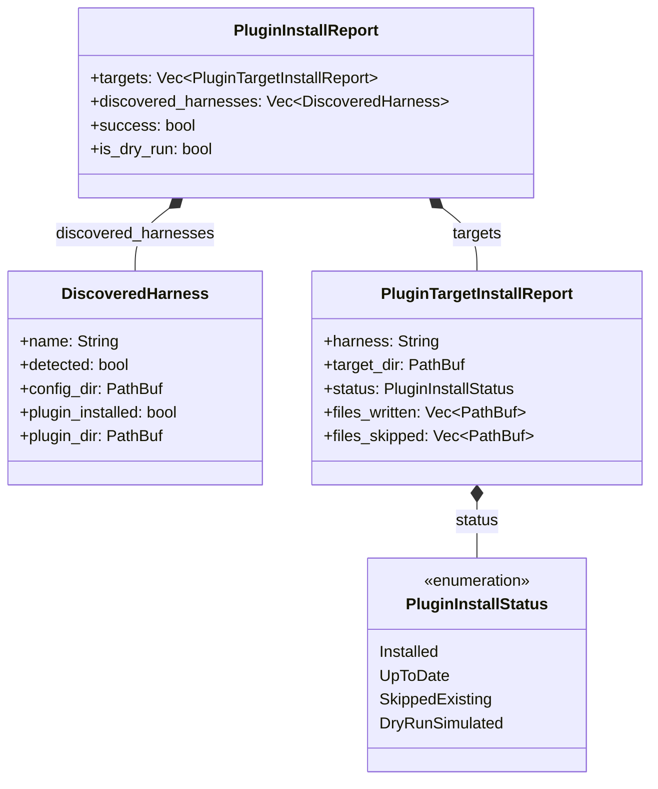

# Feature Architecture: `plugin`

🌐 **[Open Interactive Diagram (Pele Playground)](https://pele.run/playground#source=classDiagram%0A++++direction+TB%0A%0A++++%25%25+%3D%3D%3D%3D%3D%3D%3D%3D%3D%3D%3D%3D%3D%3D%3D%3D%3D%3D%3D%3D%3D%3D%3D%3D%3D%3D%3D%3D%3D%3D%3D%3D%3D%3D%3D%3D%3D%3D%3D%3D%3D%3D%3D%3D%3D%3D%3D%3D%3D%3D%3D%3D%3D%3D%3D%3D%3D%3D%3D%3D%3D%3D%3D%3D%3D%3D%3D%3D%0A++++%25%25+%F0%9F%A7%A9+Feature+Slice%3A+plugin+%28with+1-hop+domain+neighbors%29%0A++++%25%25+%3D%3D%3D%3D%3D%3D%3D%3D%3D%3D%3D%3D%3D%3D%3D%3D%3D%3D%3D%3D%3D%3D%3D%3D%3D%3D%3D%3D%3D%3D%3D%3D%3D%3D%3D%3D%3D%3D%3D%3D%3D%3D%3D%3D%3D%3D%3D%3D%3D%3D%3D%3D%3D%3D%3D%3D%3D%3D%3D%3D%3D%3D%3D%3D%3D%3D%3D%3D%0A%0A++++class+DiscoveredHarness+%7B%0A++++++++%2Bname%3A+String%0A++++++++%2Bdetected%3A+bool%0A++++++++%2Bconfig_dir%3A+PathBuf%0A++++++++%2Bplugin_installed%3A+bool%0A++++++++%2Bplugin_dir%3A+PathBuf%0A++++%7D%0A%0A++++class+PluginInstallReport+%7B%0A++++++++%2Btargets%3A+Vec%7EPluginTargetInstallReport%7E%0A++++++++%2Bdiscovered_harnesses%3A+Vec%7EDiscoveredHarness%7E%0A++++++++%2Bsuccess%3A+bool%0A++++++++%2Bis_dry_run%3A+bool%0A++++%7D%0A%0A++++class+PluginInstallStatus+%7B%0A++++++++%3C%3Cenumeration%3E%3E%0A++++++++Installed%0A++++++++UpToDate%0A++++++++SkippedExisting%0A++++++++DryRunSimulated%0A++++%7D%0A%0A++++class+PluginTargetInstallReport+%7B%0A++++++++%2Bharness%3A+String%0A++++++++%2Btarget_dir%3A+PathBuf%0A++++++++%2Bstatus%3A+PluginInstallStatus%0A++++++++%2Bfiles_written%3A+Vec%7EPathBuf%7E%0A++++++++%2Bfiles_skipped%3A+Vec%7EPathBuf%7E%0A++++%7D%0A%0A++++PluginTargetInstallReport+*--+PluginInstallStatus+%3A+status%0A++++PluginInstallReport+*--+PluginTargetInstallReport+%3A+targets%0A++++PluginInstallReport+*--+DiscoveredHarness+%3A+discovered_harnesses)** • ← [Full Architecture](../../architecture.md) • 📋 [Feature Spec](../../specs/plugin.md)

> Scoped domænemodel for `plugin` (inkl. direkte 1-hop naborelationer). Åbn lokalt med pan/zoom via `xgauntlet topology open --feature plugin`.

