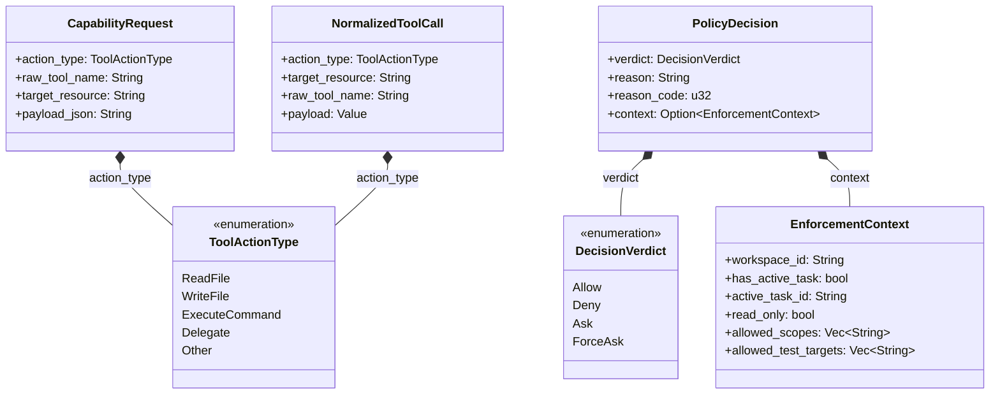

# Feature Architecture: `policy`

🌐 **[Open Interactive Diagram (Mermaid Live)](https://mermaid.live/view#base64:eyJjb2RlIjoiY2xhc3NEaWFncmFtXG4gICAgZGlyZWN0aW9uIFRCXG5cbiAgICAlJSA9PT09PT09PT09PT09PT09PT09PT09PT09PT09PT09PT09PT09PT09PT09PT09PT09PT09PT09PT09PT09PT09PT09PVxuICAgICUlIPCfp6kgRmVhdHVyZSBTbGljZTogcG9saWN5ICh3aXRoIDEtaG9wIGRvbWFpbiBuZWlnaGJvcnMpXG4gICAgJSUgPT09PT09PT09PT09PT09PT09PT09PT09PT09PT09PT09PT09PT09PT09PT09PT09PT09PT09PT09PT09PT09PT09PT1cblxuICAgIGNsYXNzIENhcGFiaWxpdHlSZXF1ZXN0IHtcbiAgICAgICAgK2FjdGlvbl90eXBlOiBUb29sQWN0aW9uVHlwZVxuICAgICAgICArcmF3X3Rvb2xfbmFtZTogU3RyaW5nXG4gICAgICAgICt0YXJnZXRfcmVzb3VyY2U6IFN0cmluZ1xuICAgICAgICArcGF5bG9hZF9qc29uOiBTdHJpbmdcbiAgICB9XG5cbiAgICBjbGFzcyBEZWNpc2lvblZlcmRpY3Qge1xuICAgICAgICA8PGVudW1lcmF0aW9uPj5cbiAgICAgICAgQWxsb3dcbiAgICAgICAgRGVueVxuICAgICAgICBBc2tcbiAgICAgICAgRm9yY2VBc2tcbiAgICB9XG5cbiAgICBjbGFzcyBFbmZvcmNlbWVudENvbnRleHQge1xuICAgICAgICArd29ya3NwYWNlX2lkOiBTdHJpbmdcbiAgICAgICAgK2hhc19hY3RpdmVfdGFzazogYm9vbFxuICAgICAgICArYWN0aXZlX3Rhc2tfaWQ6IFN0cmluZ1xuICAgICAgICArcmVhZF9vbmx5OiBib29sXG4gICAgICAgICthbGxvd2VkX3Njb3BlczogVmVjflN0cmluZ35cbiAgICAgICAgK2FsbG93ZWRfdGVzdF90YXJnZXRzOiBWZWN+U3RyaW5nflxuICAgIH1cblxuICAgIGNsYXNzIE5vcm1hbGl6ZWRUb29sQ2FsbCB7XG4gICAgICAgICthY3Rpb25fdHlwZTogVG9vbEFjdGlvblR5cGVcbiAgICAgICAgK3RhcmdldF9yZXNvdXJjZTogU3RyaW5nXG4gICAgICAgICtyYXdfdG9vbF9uYW1lOiBTdHJpbmdcbiAgICAgICAgK3BheWxvYWQ6IFZhbHVlXG4gICAgfVxuXG4gICAgY2xhc3MgUG9saWN5RGVjaXNpb24ge1xuICAgICAgICArdmVyZGljdDogRGVjaXNpb25WZXJkaWN0XG4gICAgICAgICtyZWFzb246IFN0cmluZ1xuICAgICAgICArcmVhc29uX2NvZGU6IHUzMlxuICAgICAgICArY29udGV4dDogT3B0aW9ufkVuZm9yY2VtZW50Q29udGV4dH5cbiAgICB9XG5cbiAgICBjbGFzcyBUb29sQWN0aW9uVHlwZSB7XG4gICAgICAgIDw8ZW51bWVyYXRpb24+PlxuICAgICAgICBSZWFkRmlsZVxuICAgICAgICBXcml0ZUZpbGVcbiAgICAgICAgRXhlY3V0ZUNvbW1hbmRcbiAgICAgICAgRGVsZWdhdGVcbiAgICAgICAgT3RoZXJcbiAgICB9XG5cbiAgICBQb2xpY3lEZWNpc2lvbiAqLS0gRGVjaXNpb25WZXJkaWN0IDogdmVyZGljdFxuICAgIFBvbGljeURlY2lzaW9uICotLSBFbmZvcmNlbWVudENvbnRleHQgOiBjb250ZXh0XG4gICAgQ2FwYWJpbGl0eVJlcXVlc3QgKi0tIFRvb2xBY3Rpb25UeXBlIDogYWN0aW9uX3R5cGVcbiAgICBOb3JtYWxpemVkVG9vbENhbGwgKi0tIFRvb2xBY3Rpb25UeXBlIDogYWN0aW9uX3R5cGUiLCJtZXJtYWlkIjp7InRoZW1lIjoiZGVmYXVsdCJ9LCJhdXRvU3luYyI6dHJ1ZSwidXBkYXRlRWRpdG9yIjpmYWxzZX0=)** • ← [Full Architecture](../../architecture.md) • 📋 [Feature Spec](../../specs/policy.md)

> Scoped domænemodel for `policy` (inkl. direkte 1-hop naborelationer). Åbn lokalt med pan/zoom via `xgauntlet topology open --feature policy`.

