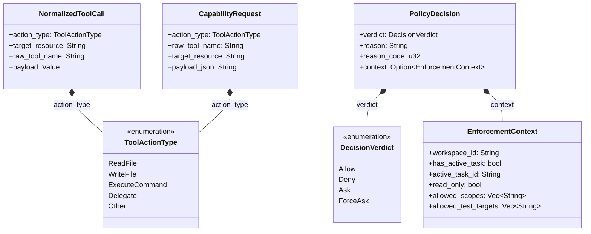

# Feature Architecture: `policy`

🌐 **[Open Interactive Diagram (Pele Playground)](https://pele.run/playground#source=classDiagram%0A++++direction+TB%0A%0A++++%25%25+%3D%3D%3D%3D%3D%3D%3D%3D%3D%3D%3D%3D%3D%3D%3D%3D%3D%3D%3D%3D%3D%3D%3D%3D%3D%3D%3D%3D%3D%3D%3D%3D%3D%3D%3D%3D%3D%3D%3D%3D%3D%3D%3D%3D%3D%3D%3D%3D%3D%3D%3D%3D%3D%3D%3D%3D%3D%3D%3D%3D%3D%3D%3D%3D%3D%3D%3D%3D%0A++++%25%25+%F0%9F%A7%A9+Feature+Slice%3A+policy+%28with+1-hop+domain+neighbors%29%0A++++%25%25+%3D%3D%3D%3D%3D%3D%3D%3D%3D%3D%3D%3D%3D%3D%3D%3D%3D%3D%3D%3D%3D%3D%3D%3D%3D%3D%3D%3D%3D%3D%3D%3D%3D%3D%3D%3D%3D%3D%3D%3D%3D%3D%3D%3D%3D%3D%3D%3D%3D%3D%3D%3D%3D%3D%3D%3D%3D%3D%3D%3D%3D%3D%3D%3D%3D%3D%3D%3D%0A%0A++++class+CapabilityRequest+%7B%0A++++++++%2Baction_type%3A+ToolActionType%0A++++++++%2Braw_tool_name%3A+String%0A++++++++%2Btarget_resource%3A+String%0A++++++++%2Bpayload_json%3A+String%0A++++%7D%0A%0A++++class+DecisionVerdict+%7B%0A++++++++%3C%3Cenumeration%3E%3E%0A++++++++Allow%0A++++++++Deny%0A++++++++Ask%0A++++++++ForceAsk%0A++++%7D%0A%0A++++class+EnforcementContext+%7B%0A++++++++%2Bworkspace_id%3A+String%0A++++++++%2Bhas_active_task%3A+bool%0A++++++++%2Bactive_task_id%3A+String%0A++++++++%2Bread_only%3A+bool%0A++++++++%2Ballowed_scopes%3A+Vec%7EString%7E%0A++++++++%2Ballowed_test_targets%3A+Vec%7EString%7E%0A++++%7D%0A%0A++++class+NormalizedToolCall+%7B%0A++++++++%2Baction_type%3A+ToolActionType%0A++++++++%2Btarget_resource%3A+String%0A++++++++%2Braw_tool_name%3A+String%0A++++++++%2Bpayload%3A+Value%0A++++%7D%0A%0A++++class+PolicyDecision+%7B%0A++++++++%2Bverdict%3A+DecisionVerdict%0A++++++++%2Breason%3A+String%0A++++++++%2Breason_code%3A+u32%0A++++++++%2Bcontext%3A+Option%7EEnforcementContext%7E%0A++++%7D%0A%0A++++class+ToolActionType+%7B%0A++++++++%3C%3Cenumeration%3E%3E%0A++++++++ReadFile%0A++++++++WriteFile%0A++++++++ExecuteCommand%0A++++++++Delegate%0A++++++++Other%0A++++%7D%0A%0A++++NormalizedToolCall+*--+ToolActionType+%3A+action_type%0A++++CapabilityRequest+*--+ToolActionType+%3A+action_type%0A++++PolicyDecision+*--+DecisionVerdict+%3A+verdict%0A++++PolicyDecision+*--+EnforcementContext+%3A+context)** • ← [Full Architecture](../../architecture.md) • 📋 [Feature Spec](../../specs/policy.md)

> Scoped domænemodel for `policy` (inkl. direkte 1-hop naborelationer). Åbn lokalt med pan/zoom via `xgauntlet topology open --feature policy`.

