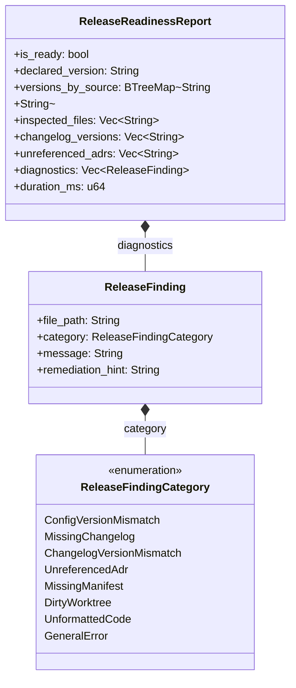

# Feature Architecture: `release`

🌐 **[Open Interactive Diagram (Pele Playground)](https://pele.run/playground#source=classDiagram%0A++++direction+TB%0A%0A++++%25%25+%3D%3D%3D%3D%3D%3D%3D%3D%3D%3D%3D%3D%3D%3D%3D%3D%3D%3D%3D%3D%3D%3D%3D%3D%3D%3D%3D%3D%3D%3D%3D%3D%3D%3D%3D%3D%3D%3D%3D%3D%3D%3D%3D%3D%3D%3D%3D%3D%3D%3D%3D%3D%3D%3D%3D%3D%3D%3D%3D%3D%3D%3D%3D%3D%3D%3D%3D%3D%0A++++%25%25+%F0%9F%A7%A9+Feature+Slice%3A+release+%28with+1-hop+domain+neighbors%29%0A++++%25%25+%3D%3D%3D%3D%3D%3D%3D%3D%3D%3D%3D%3D%3D%3D%3D%3D%3D%3D%3D%3D%3D%3D%3D%3D%3D%3D%3D%3D%3D%3D%3D%3D%3D%3D%3D%3D%3D%3D%3D%3D%3D%3D%3D%3D%3D%3D%3D%3D%3D%3D%3D%3D%3D%3D%3D%3D%3D%3D%3D%3D%3D%3D%3D%3D%3D%3D%3D%3D%0A%0A++++class+ReleaseFinding+%7B%0A++++++++%2Bfile_path%3A+String%0A++++++++%2Bcategory%3A+ReleaseFindingCategory%0A++++++++%2Bmessage%3A+String%0A++++++++%2Bremediation_hint%3A+String%0A++++%7D%0A%0A++++class+ReleaseFindingCategory+%7B%0A++++++++%3C%3Cenumeration%3E%3E%0A++++++++ConfigVersionMismatch%0A++++++++MissingChangelog%0A++++++++ChangelogVersionMismatch%0A++++++++UnreferencedAdr%0A++++++++MissingManifest%0A++++++++DirtyWorktree%0A++++++++UnformattedCode%0A++++++++GeneralError%0A++++%7D%0A%0A++++class+ReleaseReadinessReport+%7B%0A++++++++%2Bis_ready%3A+bool%0A++++++++%2Bdeclared_version%3A+String%0A++++++++%2Bversions_by_source%3A+BTreeMap%7EString%0A++++++++%2BString%7E%0A++++++++%2Binspected_files%3A+Vec%7EString%7E%0A++++++++%2Bchangelog_versions%3A+Vec%7EString%7E%0A++++++++%2Bunreferenced_adrs%3A+Vec%7EString%7E%0A++++++++%2Bdiagnostics%3A+Vec%7EReleaseFinding%7E%0A++++++++%2Bduration_ms%3A+u64%0A++++%7D%0A%0A++++ReleaseFinding+*--+ReleaseFindingCategory+%3A+category%0A++++ReleaseReadinessReport+*--+ReleaseFinding+%3A+diagnostics)** • ← [Full Architecture](../../architecture.md) • 📋 [Feature Spec](../../specs/release.md)

> Scoped domænemodel for `release` (inkl. direkte 1-hop naborelationer). Åbn lokalt med pan/zoom via `xgauntlet topology open --feature release`.

