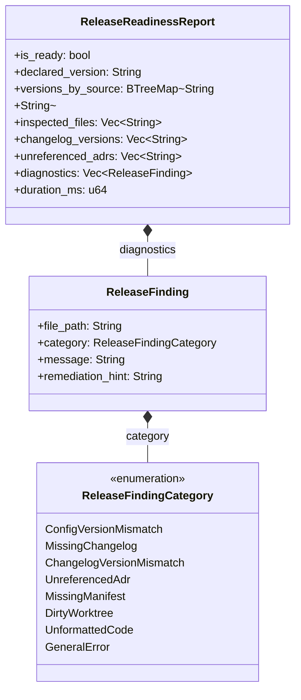

# Feature Architecture: `release`

🌐 **[Open Interactive Diagram (Mermaid Live)](https://mermaid.live/view#base64:eyJjb2RlIjoiY2xhc3NEaWFncmFtXG4gICAgZGlyZWN0aW9uIFRCXG5cbiAgICAlJSA9PT09PT09PT09PT09PT09PT09PT09PT09PT09PT09PT09PT09PT09PT09PT09PT09PT09PT09PT09PT09PT09PT09PVxuICAgICUlIPCfp6kgRmVhdHVyZSBTbGljZTogcmVsZWFzZSAod2l0aCAxLWhvcCBkb21haW4gbmVpZ2hib3JzKVxuICAgICUlID09PT09PT09PT09PT09PT09PT09PT09PT09PT09PT09PT09PT09PT09PT09PT09PT09PT09PT09PT09PT09PT09PT09XG5cbiAgICBjbGFzcyBSZWxlYXNlRmluZGluZyB7XG4gICAgICAgICtmaWxlX3BhdGg6IFN0cmluZ1xuICAgICAgICArY2F0ZWdvcnk6IFJlbGVhc2VGaW5kaW5nQ2F0ZWdvcnlcbiAgICAgICAgK21lc3NhZ2U6IFN0cmluZ1xuICAgICAgICArcmVtZWRpYXRpb25faGludDogU3RyaW5nXG4gICAgfVxuXG4gICAgY2xhc3MgUmVsZWFzZUZpbmRpbmdDYXRlZ29yeSB7XG4gICAgICAgIDw8ZW51bWVyYXRpb24+PlxuICAgICAgICBDb25maWdWZXJzaW9uTWlzbWF0Y2hcbiAgICAgICAgTWlzc2luZ0NoYW5nZWxvZ1xuICAgICAgICBDaGFuZ2Vsb2dWZXJzaW9uTWlzbWF0Y2hcbiAgICAgICAgVW5yZWZlcmVuY2VkQWRyXG4gICAgICAgIE1pc3NpbmdNYW5pZmVzdFxuICAgICAgICBEaXJ0eVdvcmt0cmVlXG4gICAgICAgIFVuZm9ybWF0dGVkQ29kZVxuICAgICAgICBHZW5lcmFsRXJyb3JcbiAgICB9XG5cbiAgICBjbGFzcyBSZWxlYXNlUmVhZGluZXNzUmVwb3J0IHtcbiAgICAgICAgK2lzX3JlYWR5OiBib29sXG4gICAgICAgICtkZWNsYXJlZF92ZXJzaW9uOiBTdHJpbmdcbiAgICAgICAgK3ZlcnNpb25zX2J5X3NvdXJjZTogQlRyZWVNYXB+U3RyaW5nXG4gICAgICAgICtTdHJpbmd+XG4gICAgICAgICtpbnNwZWN0ZWRfZmlsZXM6IFZlY35TdHJpbmd+XG4gICAgICAgICtjaGFuZ2Vsb2dfdmVyc2lvbnM6IFZlY35TdHJpbmd+XG4gICAgICAgICt1bnJlZmVyZW5jZWRfYWRyczogVmVjflN0cmluZ35cbiAgICAgICAgK2RpYWdub3N0aWNzOiBWZWN+UmVsZWFzZUZpbmRpbmd+XG4gICAgICAgICtkdXJhdGlvbl9tczogdTY0XG4gICAgfVxuXG4gICAgUmVsZWFzZVJlYWRpbmVzc1JlcG9ydCAqLS0gUmVsZWFzZUZpbmRpbmcgOiBkaWFnbm9zdGljc1xuICAgIFJlbGVhc2VGaW5kaW5nICotLSBSZWxlYXNlRmluZGluZ0NhdGVnb3J5IDogY2F0ZWdvcnkiLCJtZXJtYWlkIjp7InRoZW1lIjoiZGVmYXVsdCJ9LCJhdXRvU3luYyI6dHJ1ZSwidXBkYXRlRWRpdG9yIjpmYWxzZX0=)** • ← [Full Architecture](../../architecture.md) • 📋 [Feature Spec](../../specs/release.md)

> Scoped domænemodel for `release` (inkl. direkte 1-hop naborelationer). Åbn lokalt med pan/zoom via `xgauntlet topology open --feature release`.

