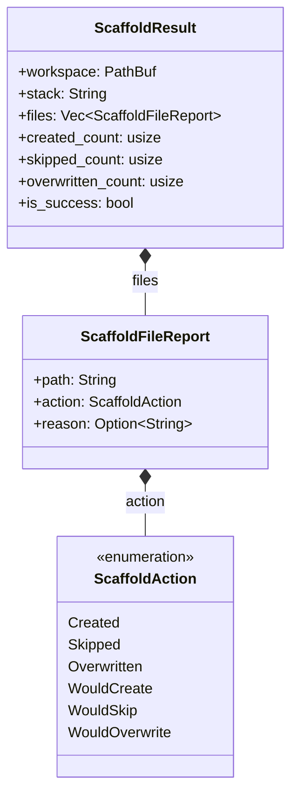

# Feature Architecture: `scaffold`

🌐 **[Open Interactive Diagram (Mermaid Live)](https://mermaid.live/view#base64:eyJjb2RlIjoiY2xhc3NEaWFncmFtXG4gICAgZGlyZWN0aW9uIFRCXG5cbiAgICAlJSA9PT09PT09PT09PT09PT09PT09PT09PT09PT09PT09PT09PT09PT09PT09PT09PT09PT09PT09PT09PT09PT09PT09PVxuICAgICUlIPCfp6kgRmVhdHVyZSBTbGljZTogc2NhZmZvbGQgKHdpdGggMS1ob3AgZG9tYWluIG5laWdoYm9ycylcbiAgICAlJSA9PT09PT09PT09PT09PT09PT09PT09PT09PT09PT09PT09PT09PT09PT09PT09PT09PT09PT09PT09PT09PT09PT09PVxuXG4gICAgY2xhc3MgU2NhZmZvbGRBY3Rpb24ge1xuICAgICAgICA8PGVudW1lcmF0aW9uPj5cbiAgICAgICAgQ3JlYXRlZFxuICAgICAgICBTa2lwcGVkXG4gICAgICAgIE92ZXJ3cml0dGVuXG4gICAgICAgIFdvdWxkQ3JlYXRlXG4gICAgICAgIFdvdWxkU2tpcFxuICAgICAgICBXb3VsZE92ZXJ3cml0ZVxuICAgIH1cblxuICAgIGNsYXNzIFNjYWZmb2xkRmlsZVJlcG9ydCB7XG4gICAgICAgICtwYXRoOiBTdHJpbmdcbiAgICAgICAgK2FjdGlvbjogU2NhZmZvbGRBY3Rpb25cbiAgICAgICAgK3JlYXNvbjogT3B0aW9uflN0cmluZ35cbiAgICB9XG5cbiAgICBjbGFzcyBTY2FmZm9sZFJlc3VsdCB7XG4gICAgICAgICt3b3Jrc3BhY2U6IFBhdGhCdWZcbiAgICAgICAgK3N0YWNrOiBTdHJpbmdcbiAgICAgICAgK2ZpbGVzOiBWZWN+U2NhZmZvbGRGaWxlUmVwb3J0flxuICAgICAgICArY3JlYXRlZF9jb3VudDogdXNpemVcbiAgICAgICAgK3NraXBwZWRfY291bnQ6IHVzaXplXG4gICAgICAgICtvdmVyd3JpdHRlbl9jb3VudDogdXNpemVcbiAgICAgICAgK2lzX3N1Y2Nlc3M6IGJvb2xcbiAgICB9XG5cbiAgICBTY2FmZm9sZFJlc3VsdCAqLS0gU2NhZmZvbGRGaWxlUmVwb3J0IDogZmlsZXNcbiAgICBTY2FmZm9sZEZpbGVSZXBvcnQgKi0tIFNjYWZmb2xkQWN0aW9uIDogYWN0aW9uIiwibWVybWFpZCI6eyJ0aGVtZSI6ImRlZmF1bHQifSwiYXV0b1N5bmMiOnRydWUsInVwZGF0ZUVkaXRvciI6ZmFsc2V9)** • ← [Full Architecture](../../architecture.md) • 📋 [Feature Spec](../../specs/scaffold.md)

> Scoped domænemodel for `scaffold` (inkl. direkte 1-hop naborelationer). Åbn lokalt med pan/zoom via `xgauntlet topology open --feature scaffold`.

