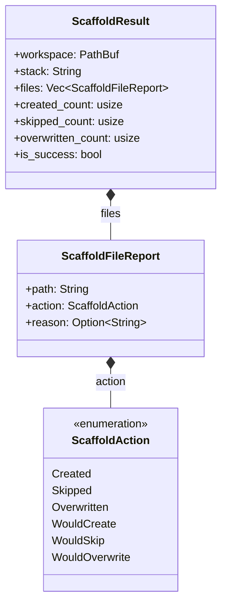

# Feature Architecture: `scaffold`

🌐 **[Open Interactive Diagram (Pele Playground)](https://pele.run/playground#source=classDiagram%0A++++direction+TB%0A%0A++++%25%25+%3D%3D%3D%3D%3D%3D%3D%3D%3D%3D%3D%3D%3D%3D%3D%3D%3D%3D%3D%3D%3D%3D%3D%3D%3D%3D%3D%3D%3D%3D%3D%3D%3D%3D%3D%3D%3D%3D%3D%3D%3D%3D%3D%3D%3D%3D%3D%3D%3D%3D%3D%3D%3D%3D%3D%3D%3D%3D%3D%3D%3D%3D%3D%3D%3D%3D%3D%3D%0A++++%25%25+%F0%9F%A7%A9+Feature+Slice%3A+scaffold+%28with+1-hop+domain+neighbors%29%0A++++%25%25+%3D%3D%3D%3D%3D%3D%3D%3D%3D%3D%3D%3D%3D%3D%3D%3D%3D%3D%3D%3D%3D%3D%3D%3D%3D%3D%3D%3D%3D%3D%3D%3D%3D%3D%3D%3D%3D%3D%3D%3D%3D%3D%3D%3D%3D%3D%3D%3D%3D%3D%3D%3D%3D%3D%3D%3D%3D%3D%3D%3D%3D%3D%3D%3D%3D%3D%3D%3D%0A%0A++++class+ScaffoldAction+%7B%0A++++++++%3C%3Cenumeration%3E%3E%0A++++++++Created%0A++++++++Skipped%0A++++++++Overwritten%0A++++++++WouldCreate%0A++++++++WouldSkip%0A++++++++WouldOverwrite%0A++++%7D%0A%0A++++class+ScaffoldFileReport+%7B%0A++++++++%2Bpath%3A+String%0A++++++++%2Baction%3A+ScaffoldAction%0A++++++++%2Breason%3A+Option%7EString%7E%0A++++%7D%0A%0A++++class+ScaffoldResult+%7B%0A++++++++%2Bworkspace%3A+PathBuf%0A++++++++%2Bstack%3A+String%0A++++++++%2Bfiles%3A+Vec%7EScaffoldFileReport%7E%0A++++++++%2Bcreated_count%3A+usize%0A++++++++%2Bskipped_count%3A+usize%0A++++++++%2Boverwritten_count%3A+usize%0A++++++++%2Bis_success%3A+bool%0A++++%7D%0A%0A++++ScaffoldResult+*--+ScaffoldFileReport+%3A+files%0A++++ScaffoldFileReport+*--+ScaffoldAction+%3A+action)** • ← [Full Architecture](../../architecture.md) • 📋 [Feature Spec](../../specs/scaffold.md)

> Scoped domænemodel for `scaffold` (inkl. direkte 1-hop naborelationer). Åbn lokalt med pan/zoom via `xgauntlet topology open --feature scaffold`.

