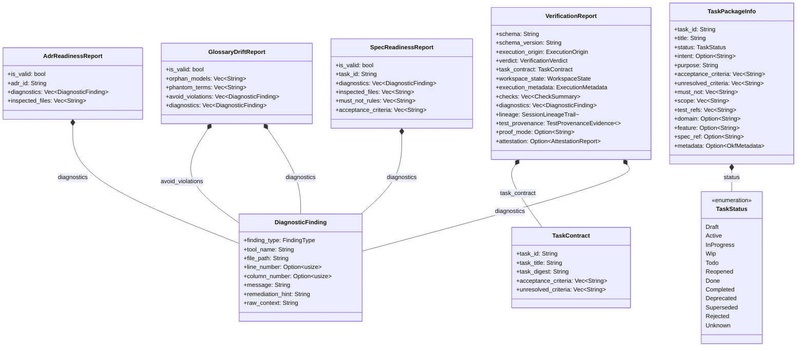

# Feature Architecture: `tasks`

🌐 **[Open Interactive Diagram (Mermaid Live)](https://mermaid.live/view#base64:eyJjb2RlIjoiY2xhc3NEaWFncmFtXG4gICAgZGlyZWN0aW9uIFRCXG5cbiAgICAlJSA9PT09PT09PT09PT09PT09PT09PT09PT09PT09PT09PT09PT09PT09PT09PT09PT09PT09PT09PT09PT09PT09PT09PVxuICAgICUlIPCfp6kgRmVhdHVyZSBTbGljZTogdGFza3MgKHdpdGggMS1ob3AgZG9tYWluIG5laWdoYm9ycylcbiAgICAlJSA9PT09PT09PT09PT09PT09PT09PT09PT09PT09PT09PT09PT09PT09PT09PT09PT09PT09PT09PT09PT09PT09PT09PVxuXG4gICAgY2xhc3MgQWRyUmVhZGluZXNzUmVwb3J0IHtcbiAgICAgICAgK2lzX3ZhbGlkOiBib29sXG4gICAgICAgICthZHJfaWQ6IFN0cmluZ1xuICAgICAgICArZGlhZ25vc3RpY3M6IFZlY35EaWFnbm9zdGljRmluZGluZ35cbiAgICAgICAgK2luc3BlY3RlZF9maWxlczogVmVjflN0cmluZ35cbiAgICB9XG5cbiAgICBjbGFzcyBEaWFnbm9zdGljRmluZGluZyB7XG4gICAgICAgICtmaW5kaW5nX3R5cGU6IEZpbmRpbmdUeXBlXG4gICAgICAgICt0b29sX25hbWU6IFN0cmluZ1xuICAgICAgICArZmlsZV9wYXRoOiBTdHJpbmdcbiAgICAgICAgK2xpbmVfbnVtYmVyOiBPcHRpb25+dXNpemV+XG4gICAgICAgICtjb2x1bW5fbnVtYmVyOiBPcHRpb25+dXNpemV+XG4gICAgICAgICttZXNzYWdlOiBTdHJpbmdcbiAgICAgICAgK3JlbWVkaWF0aW9uX2hpbnQ6IFN0cmluZ1xuICAgICAgICArcmF3X2NvbnRleHQ6IFN0cmluZ1xuICAgIH1cblxuICAgIGNsYXNzIEdsb3NzYXJ5RHJpZnRSZXBvcnQge1xuICAgICAgICAraXNfdmFsaWQ6IGJvb2xcbiAgICAgICAgK29ycGhhbl9tb2RlbHM6IFZlY35TdHJpbmd+XG4gICAgICAgICtwaGFudG9tX3Rlcm1zOiBWZWN+U3RyaW5nflxuICAgICAgICArYXZvaWRfdmlvbGF0aW9uczogVmVjfkRpYWdub3N0aWNGaW5kaW5nflxuICAgICAgICArZGlhZ25vc3RpY3M6IFZlY35EaWFnbm9zdGljRmluZGluZ35cbiAgICB9XG5cbiAgICBjbGFzcyBTcGVjUmVhZGluZXNzUmVwb3J0IHtcbiAgICAgICAgK2lzX3ZhbGlkOiBib29sXG4gICAgICAgICt0YXNrX2lkOiBTdHJpbmdcbiAgICAgICAgK2RpYWdub3N0aWNzOiBWZWN+RGlhZ25vc3RpY0ZpbmRpbmd+XG4gICAgICAgICtpbnNwZWN0ZWRfZmlsZXM6IFZlY35TdHJpbmd+XG4gICAgICAgICttdXN0X25vdF9ydWxlczogVmVjflN0cmluZ35cbiAgICAgICAgK2FjY2VwdGFuY2VfY3JpdGVyaWE6IFZlY35TdHJpbmd+XG4gICAgfVxuXG4gICAgY2xhc3MgVGFza0NvbnRyYWN0IHtcbiAgICAgICAgK3Rhc2tfaWQ6IFN0cmluZ1xuICAgICAgICArdGFza190aXRsZTogU3RyaW5nXG4gICAgICAgICt0YXNrX2RpZ2VzdDogU3RyaW5nXG4gICAgICAgICthY2NlcHRhbmNlX2NyaXRlcmlhOiBWZWN+U3RyaW5nflxuICAgICAgICArdW5yZXNvbHZlZF9jcml0ZXJpYTogVmVjflN0cmluZ35cbiAgICB9XG5cbiAgICBjbGFzcyBUYXNrUGFja2FnZUluZm8ge1xuICAgICAgICArdGFza19pZDogU3RyaW5nXG4gICAgICAgICt0aXRsZTogU3RyaW5nXG4gICAgICAgICtzdGF0dXM6IFRhc2tTdGF0dXNcbiAgICAgICAgK2ludGVudDogT3B0aW9uflN0cmluZ35cbiAgICAgICAgK3B1cnBvc2U6IFN0cmluZ1xuICAgICAgICArYWNjZXB0YW5jZV9jcml0ZXJpYTogVmVjflN0cmluZ35cbiAgICAgICAgK3VucmVzb2x2ZWRfY3JpdGVyaWE6IFZlY35TdHJpbmd+XG4gICAgICAgICttdXN0X25vdDogVmVjflN0cmluZ35cbiAgICAgICAgK3Njb3BlOiBWZWN+U3RyaW5nflxuICAgICAgICArdGVzdF9yZWZzOiBWZWN+U3RyaW5nflxuICAgICAgICArZG9tYWluOiBPcHRpb25+U3RyaW5nflxuICAgICAgICArZmVhdHVyZTogT3B0aW9uflN0cmluZ35cbiAgICAgICAgK3NwZWNfcmVmOiBPcHRpb25+U3RyaW5nflxuICAgICAgICArbWV0YWRhdGE6IE9wdGlvbn5Pa2ZNZXRhZGF0YX5cbiAgICB9XG5cbiAgICBjbGFzcyBUYXNrU3RhdHVzIHtcbiAgICAgICAgPDxlbnVtZXJhdGlvbj4+XG4gICAgICAgIERyYWZ0XG4gICAgICAgIEFjdGl2ZVxuICAgICAgICBJblByb2dyZXNzXG4gICAgICAgIFdpcFxuICAgICAgICBUb2RvXG4gICAgICAgIFJlb3BlbmVkXG4gICAgICAgIERvbmVcbiAgICAgICAgQ29tcGxldGVkXG4gICAgICAgIERlcHJlY2F0ZWRcbiAgICAgICAgU3VwZXJzZWRlZFxuICAgICAgICBSZWplY3RlZFxuICAgICAgICBVbmtub3duXG4gICAgfVxuXG4gICAgY2xhc3MgVmVyaWZpY2F0aW9uUmVwb3J0IHtcbiAgICAgICAgK3NjaGVtYTogU3RyaW5nXG4gICAgICAgICtzY2hlbWFfdmVyc2lvbjogU3RyaW5nXG4gICAgICAgICtleGVjdXRpb25fb3JpZ2luOiBFeGVjdXRpb25PcmlnaW5cbiAgICAgICAgK3ZlcmRpY3Q6IFZlcmlmaWNhdGlvblZlcmRpY3RcbiAgICAgICAgK3Rhc2tfY29udHJhY3Q6IFRhc2tDb250cmFjdFxuICAgICAgICArd29ya3NwYWNlX3N0YXRlOiBXb3Jrc3BhY2VTdGF0ZVxuICAgICAgICArZXhlY3V0aW9uX21ldGFkYXRhOiBFeGVjdXRpb25NZXRhZGF0YVxuICAgICAgICArY2hlY2tzOiBWZWN+Q2hlY2tTdW1tYXJ5flxuICAgICAgICArZGlhZ25vc3RpY3M6IFZlY35EaWFnbm9zdGljRmluZGluZ35cbiAgICAgICAgK2xpbmVhZ2U6IFNlc3Npb25MaW5lYWdlVHJhaWx+XG4gICAgICAgICt0ZXN0X3Byb3ZlbmFuY2U6IFRlc3RQcm92ZW5hbmNlRXZpZGVuY2V+flxuICAgICAgICArcHJvb2ZfbW9kZTogT3B0aW9uflN0cmluZ35cbiAgICAgICAgK2F0dGVzdGF0aW9uOiBPcHRpb25+QXR0ZXN0YXRpb25SZXBvcnR+XG4gICAgfVxuXG4gICAgQWRyUmVhZGluZXNzUmVwb3J0ICotLSBEaWFnbm9zdGljRmluZGluZyA6IGRpYWdub3N0aWNzXG4gICAgR2xvc3NhcnlEcmlmdFJlcG9ydCAqLS0gRGlhZ25vc3RpY0ZpbmRpbmcgOiBhdm9pZF92aW9sYXRpb25zXG4gICAgR2xvc3NhcnlEcmlmdFJlcG9ydCAqLS0gRGlhZ25vc3RpY0ZpbmRpbmcgOiBkaWFnbm9zdGljc1xuICAgIFZlcmlmaWNhdGlvblJlcG9ydCAqLS0gVGFza0NvbnRyYWN0IDogdGFza19jb250cmFjdFxuICAgIFZlcmlmaWNhdGlvblJlcG9ydCAqLS0gRGlhZ25vc3RpY0ZpbmRpbmcgOiBkaWFnbm9zdGljc1xuICAgIFNwZWNSZWFkaW5lc3NSZXBvcnQgKi0tIERpYWdub3N0aWNGaW5kaW5nIDogZGlhZ25vc3RpY3NcbiAgICBUYXNrUGFja2FnZUluZm8gKi0tIFRhc2tTdGF0dXMgOiBzdGF0dXMiLCJtZXJtYWlkIjp7InRoZW1lIjoiZGVmYXVsdCJ9LCJhdXRvU3luYyI6dHJ1ZSwidXBkYXRlRWRpdG9yIjpmYWxzZX0=)** • ← [Full Architecture](../../architecture.md) • 📋 [Feature Spec](../../specs/tasks.md)

> Scoped domænemodel for `tasks` (inkl. direkte 1-hop naborelationer). Åbn lokalt med pan/zoom via `xgauntlet topology open --feature tasks`.

