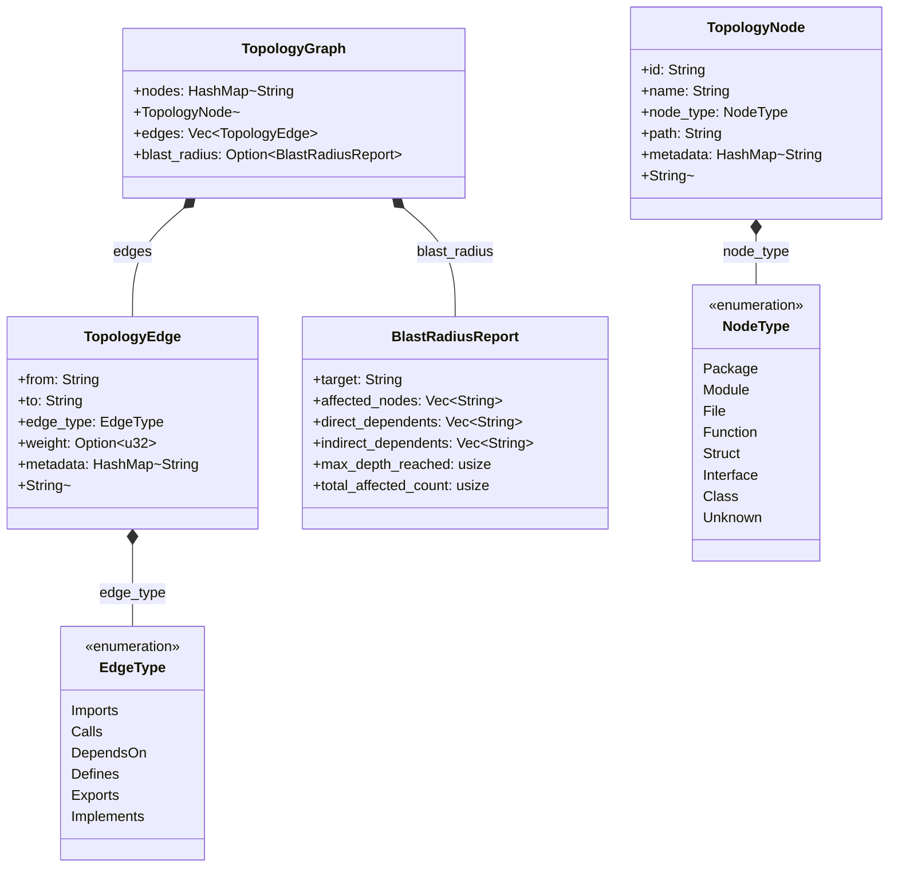

# Feature Architecture: `topology`

🌐 **[Open Interactive Diagram (Pele Playground)](https://pele.run/playground#source=classDiagram%0A++++direction+TB%0A%0A++++%25%25+%3D%3D%3D%3D%3D%3D%3D%3D%3D%3D%3D%3D%3D%3D%3D%3D%3D%3D%3D%3D%3D%3D%3D%3D%3D%3D%3D%3D%3D%3D%3D%3D%3D%3D%3D%3D%3D%3D%3D%3D%3D%3D%3D%3D%3D%3D%3D%3D%3D%3D%3D%3D%3D%3D%3D%3D%3D%3D%3D%3D%3D%3D%3D%3D%3D%3D%3D%3D%0A++++%25%25+%F0%9F%A7%A9+Feature+Slice%3A+topology+%28with+1-hop+domain+neighbors%29%0A++++%25%25+%3D%3D%3D%3D%3D%3D%3D%3D%3D%3D%3D%3D%3D%3D%3D%3D%3D%3D%3D%3D%3D%3D%3D%3D%3D%3D%3D%3D%3D%3D%3D%3D%3D%3D%3D%3D%3D%3D%3D%3D%3D%3D%3D%3D%3D%3D%3D%3D%3D%3D%3D%3D%3D%3D%3D%3D%3D%3D%3D%3D%3D%3D%3D%3D%3D%3D%3D%3D%0A%0A++++class+BlastRadiusReport+%7B%0A++++++++%2Btarget%3A+String%0A++++++++%2Baffected_nodes%3A+Vec%7EString%7E%0A++++++++%2Bdirect_dependents%3A+Vec%7EString%7E%0A++++++++%2Bindirect_dependents%3A+Vec%7EString%7E%0A++++++++%2Bmax_depth_reached%3A+usize%0A++++++++%2Btotal_affected_count%3A+usize%0A++++%7D%0A%0A++++class+EdgeType+%7B%0A++++++++%3C%3Cenumeration%3E%3E%0A++++++++Imports%0A++++++++Calls%0A++++++++DependsOn%0A++++++++Defines%0A++++++++Exports%0A++++++++Implements%0A++++%7D%0A%0A++++class+NodeType+%7B%0A++++++++%3C%3Cenumeration%3E%3E%0A++++++++Package%0A++++++++Module%0A++++++++File%0A++++++++Function%0A++++++++Struct%0A++++++++Interface%0A++++++++Class%0A++++++++Unknown%0A++++%7D%0A%0A++++class+TopologyEdge+%7B%0A++++++++%2Bfrom%3A+String%0A++++++++%2Bto%3A+String%0A++++++++%2Bedge_type%3A+EdgeType%0A++++++++%2Bweight%3A+Option%7Eu32%7E%0A++++++++%2Bmetadata%3A+HashMap%7EString%0A++++++++%2BString%7E%0A++++%7D%0A%0A++++class+TopologyGraph+%7B%0A++++++++%2Bnodes%3A+HashMap%7EString%0A++++++++%2BTopologyNode%7E%0A++++++++%2Bedges%3A+Vec%7ETopologyEdge%7E%0A++++++++%2Bblast_radius%3A+Option%7EBlastRadiusReport%7E%0A++++%7D%0A%0A++++class+TopologyNode+%7B%0A++++++++%2Bid%3A+String%0A++++++++%2Bname%3A+String%0A++++++++%2Bnode_type%3A+NodeType%0A++++++++%2Bpath%3A+String%0A++++++++%2Bmetadata%3A+HashMap%7EString%0A++++++++%2BString%7E%0A++++%7D%0A%0A++++TopologyEdge+*--+EdgeType+%3A+edge_type%0A++++TopologyGraph+*--+TopologyEdge+%3A+edges%0A++++TopologyGraph+*--+BlastRadiusReport+%3A+blast_radius%0A++++TopologyNode+*--+NodeType+%3A+node_type)** • ← [Full Architecture](../../architecture.md) • 📋 [Feature Spec](../../specs/topology.md)

> Scoped domænemodel for `topology` (inkl. direkte 1-hop naborelationer). Åbn lokalt med pan/zoom via `xgauntlet topology open --feature topology`.

