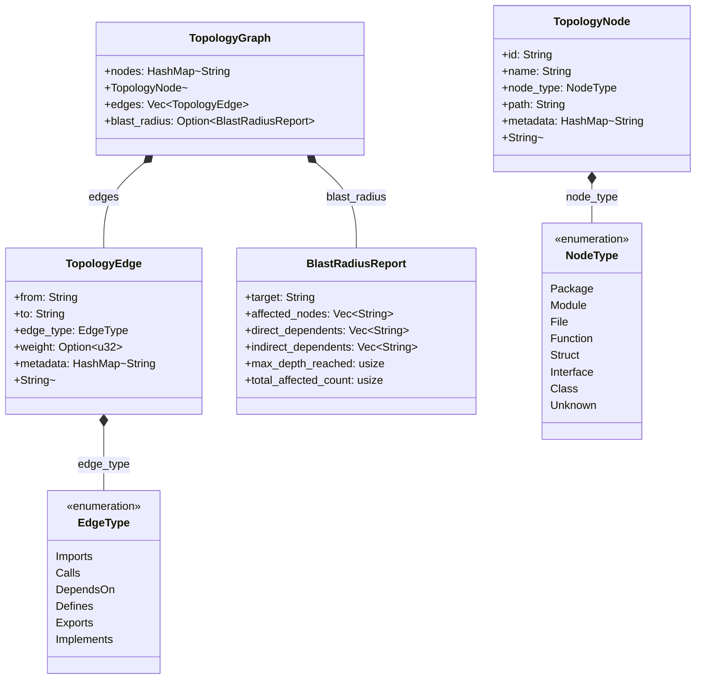

# Feature Architecture: `topology`

🌐 **[Open Interactive Diagram (Mermaid Live)](https://mermaid.live/view#base64:eyJjb2RlIjoiY2xhc3NEaWFncmFtXG4gICAgZGlyZWN0aW9uIFRCXG5cbiAgICAlJSA9PT09PT09PT09PT09PT09PT09PT09PT09PT09PT09PT09PT09PT09PT09PT09PT09PT09PT09PT09PT09PT09PT09PVxuICAgICUlIPCfp6kgRmVhdHVyZSBTbGljZTogdG9wb2xvZ3kgKHdpdGggMS1ob3AgZG9tYWluIG5laWdoYm9ycylcbiAgICAlJSA9PT09PT09PT09PT09PT09PT09PT09PT09PT09PT09PT09PT09PT09PT09PT09PT09PT09PT09PT09PT09PT09PT09PVxuXG4gICAgY2xhc3MgQmxhc3RSYWRpdXNSZXBvcnQge1xuICAgICAgICArdGFyZ2V0OiBTdHJpbmdcbiAgICAgICAgK2FmZmVjdGVkX25vZGVzOiBWZWN+U3RyaW5nflxuICAgICAgICArZGlyZWN0X2RlcGVuZGVudHM6IFZlY35TdHJpbmd+XG4gICAgICAgICtpbmRpcmVjdF9kZXBlbmRlbnRzOiBWZWN+U3RyaW5nflxuICAgICAgICArbWF4X2RlcHRoX3JlYWNoZWQ6IHVzaXplXG4gICAgICAgICt0b3RhbF9hZmZlY3RlZF9jb3VudDogdXNpemVcbiAgICB9XG5cbiAgICBjbGFzcyBFZGdlVHlwZSB7XG4gICAgICAgIDw8ZW51bWVyYXRpb24+PlxuICAgICAgICBJbXBvcnRzXG4gICAgICAgIENhbGxzXG4gICAgICAgIERlcGVuZHNPblxuICAgICAgICBEZWZpbmVzXG4gICAgICAgIEV4cG9ydHNcbiAgICAgICAgSW1wbGVtZW50c1xuICAgIH1cblxuICAgIGNsYXNzIE5vZGVUeXBlIHtcbiAgICAgICAgPDxlbnVtZXJhdGlvbj4+XG4gICAgICAgIFBhY2thZ2VcbiAgICAgICAgTW9kdWxlXG4gICAgICAgIEZpbGVcbiAgICAgICAgRnVuY3Rpb25cbiAgICAgICAgU3RydWN0XG4gICAgICAgIEludGVyZmFjZVxuICAgICAgICBDbGFzc1xuICAgICAgICBVbmtub3duXG4gICAgfVxuXG4gICAgY2xhc3MgVG9wb2xvZ3lFZGdlIHtcbiAgICAgICAgK2Zyb206IFN0cmluZ1xuICAgICAgICArdG86IFN0cmluZ1xuICAgICAgICArZWRnZV90eXBlOiBFZGdlVHlwZVxuICAgICAgICArd2VpZ2h0OiBPcHRpb25+dTMyflxuICAgICAgICArbWV0YWRhdGE6IEhhc2hNYXB+U3RyaW5nXG4gICAgICAgICtTdHJpbmd+XG4gICAgfVxuXG4gICAgY2xhc3MgVG9wb2xvZ3lHcmFwaCB7XG4gICAgICAgICtub2RlczogSGFzaE1hcH5TdHJpbmdcbiAgICAgICAgK1RvcG9sb2d5Tm9kZX5cbiAgICAgICAgK2VkZ2VzOiBWZWN+VG9wb2xvZ3lFZGdlflxuICAgICAgICArYmxhc3RfcmFkaXVzOiBPcHRpb25+Qmxhc3RSYWRpdXNSZXBvcnR+XG4gICAgfVxuXG4gICAgY2xhc3MgVG9wb2xvZ3lOb2RlIHtcbiAgICAgICAgK2lkOiBTdHJpbmdcbiAgICAgICAgK25hbWU6IFN0cmluZ1xuICAgICAgICArbm9kZV90eXBlOiBOb2RlVHlwZVxuICAgICAgICArcGF0aDogU3RyaW5nXG4gICAgICAgICttZXRhZGF0YTogSGFzaE1hcH5TdHJpbmdcbiAgICAgICAgK1N0cmluZ35cbiAgICB9XG5cbiAgICBUb3BvbG9neUVkZ2UgKi0tIEVkZ2VUeXBlIDogZWRnZV90eXBlXG4gICAgVG9wb2xvZ3lHcmFwaCAqLS0gVG9wb2xvZ3lFZGdlIDogZWRnZXNcbiAgICBUb3BvbG9neUdyYXBoICotLSBCbGFzdFJhZGl1c1JlcG9ydCA6IGJsYXN0X3JhZGl1c1xuICAgIFRvcG9sb2d5Tm9kZSAqLS0gTm9kZVR5cGUgOiBub2RlX3R5cGUiLCJtZXJtYWlkIjp7InRoZW1lIjoiZGVmYXVsdCJ9LCJhdXRvU3luYyI6dHJ1ZSwidXBkYXRlRWRpdG9yIjpmYWxzZX0=)** • ← [Full Architecture](../../architecture.md) • 📋 [Feature Spec](../../specs/topology.md)

> Scoped domænemodel for `topology` (inkl. direkte 1-hop naborelationer). Åbn lokalt med pan/zoom via `xgauntlet topology open --feature topology`.

